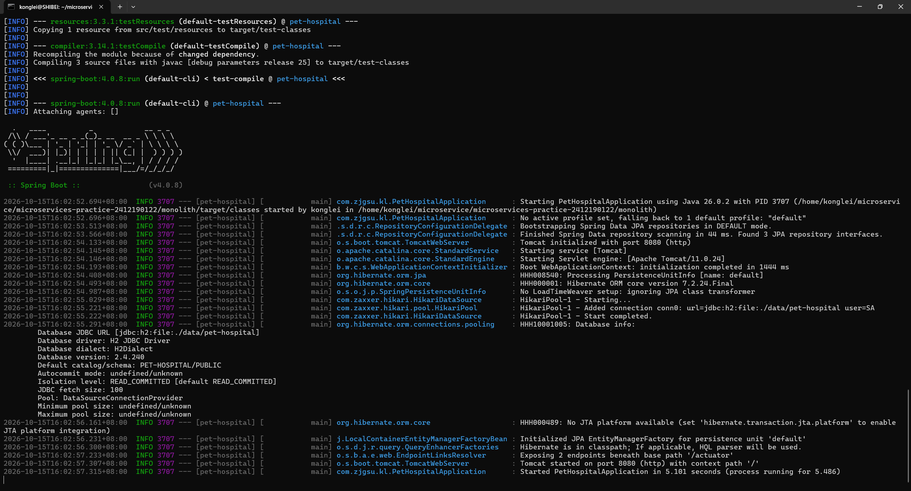
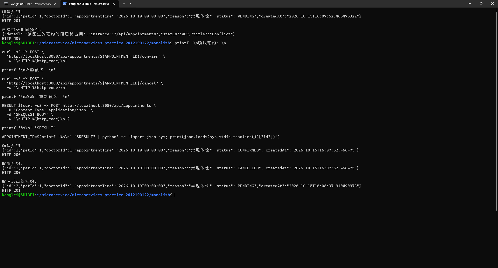
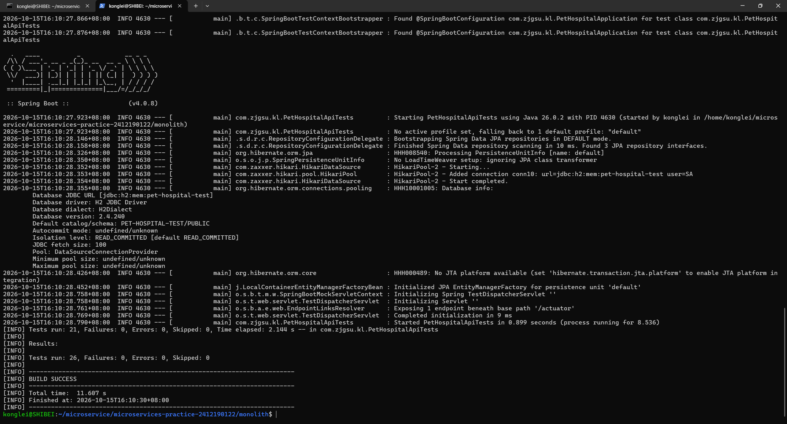
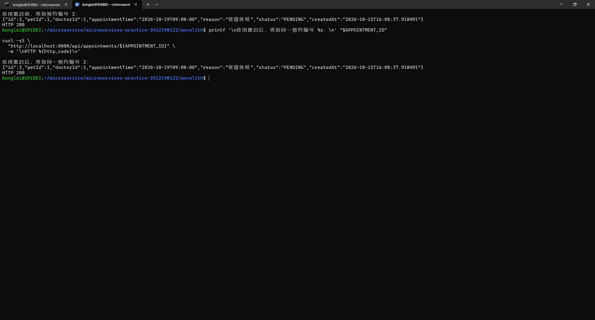
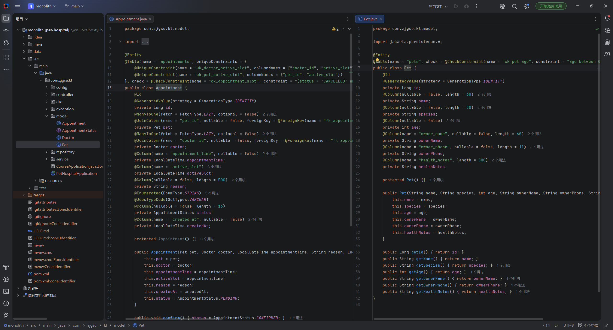
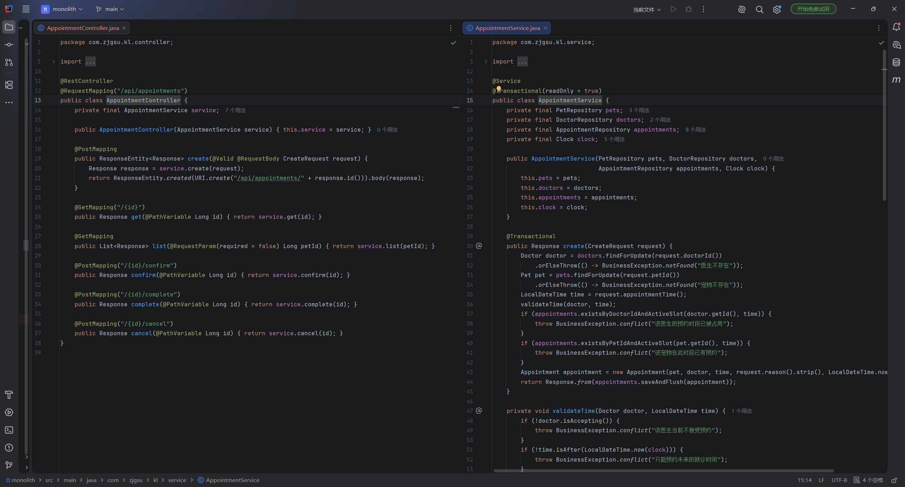
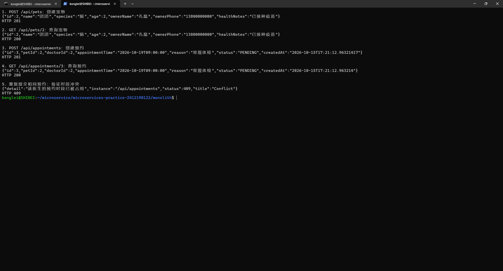

# 第 04 周作业记录

## 选题与实现范围

沿用第三周的宠物医院管理系统，本周实现“宠物就诊预约”业务流程：建立宠物档案，登记医生及每周出诊时段，提交预约，查询预约，执行确认、完成或取消操作。核心实体为 `Pet`、`Appointment`，另以 `Doctor` 支撑排班和冲突校验。

继续使用原仓库，将原 `monolith/pet-hospital/` 中的工程文件移至 `monolith/`，现有 `monolith/pom.xml` 与 `monolith/src/` 属于同一个 Maven 工程。Java 基础包保持 `com.zjgsu.kl`。第三周的问候接口、健康检查和 `contextLoads` 启动测试继续保留。

## 业务建模

### 实现思路

本周选择“宠物就诊预约”作为核心业务流程，在第三周已经能够启动的工程上继续开发。先建立宠物档案和医生出诊信息，再通过接口提交预约，完成预约的查询、确认、完成和取消操作。

业务建模以 `Pet` 和 `Appointment` 为两个核心实体，同时使用 `Doctor` 支撑排班和接诊校验。一个宠物可以有多条预约，一名医生也可以接收多条预约；每条预约只关联一个宠物和一名医生，通过数据库外键保证关联有效。

实现时使用 Controller 接收请求，DTO 校验请求参数，Service 负责业务判断和状态变化，Repository 负责数据库读写。重点在 `AppointmentService` 中检查同一医生的同一时段是否已被占用，发生冲突时返回 `409`；取消预约时释放时段并保留历史记录。完整业务说明已补充到 `docs/project-proposal.md` 的“第四周工作”部分。

### 本周完成内容

- 建立宠物、医生、预约的 JPA 实体和 Repository，实现数据库写入与查询。
- 使用 Service 完成预约时间、接诊状态、排班、重复预约和状态流转校验。
- 使用 DTO、参数校验、REST Controller 和统一 `ProblemDetail` 异常响应提供接口。
- 使用 MySQL 保存运行数据，应用重启后仍可查询；测试采用独立 H2 内存数据库。
- 编写业务规则和接口、持久化相关测试，数据库设计记录在 `docs/database.md`。

本周尚未实现独立主人账户、登录权限、病历、收费、通知、前端及微服务拆分；每名医生只配置一个每周重复的出诊时段。

### 运行环境与命令

编译目标为 Java 25，当前开发环境为 WSL Ubuntu 的 JDK 26，使用项目 Maven Wrapper。Windows PowerShell 中先输入：

```powershell
wsl -d Ubuntu
```

在 WSL 中执行测试：

```bash
cd /home/konglei/microservice/microservices-practice-2412190122/monolith
./mvnw test
```

启动应用：

```bash
cd /home/konglei/microservice/microservices-practice-2412190122/monolith
./mvnw spring-boot:run
```

默认监听 `8080` 端口，数据库持久化阶段已接入本地 MySQL 的 `pet_hospital` 数据库。可通过 `DB_URL`、`DB_USERNAME`、`DB_PASSWORD` 配置连接，本机密码可保存在已忽略的 `monolith/application-local.properties` 中。安装、建库及授权命令见 README。

### 接口约定

| 方法与路径 | 请求或用途 | 成功状态 |
| --- | --- | --- |
| GET `/api/hello?name=KongLei` | 第三周问候接口 | 200 |
| GET `/actuator/health` | 健康检查 | 200 |
| POST `/api/pets` | 创建宠物档案 | 201 |
| GET `/api/pets` | 宠物列表 | 200 |
| GET `/api/pets/{id}` | 宠物详情 | 200 |
| POST `/api/doctors` | 登记医生及出诊安排 | 201 |
| GET `/api/doctors` | 医生列表 | 200 |
| GET `/api/doctors/{id}` | 医生详情 | 200 |
| POST `/api/appointments` | 创建预约 | 201 |
| GET `/api/appointments` | 全部预约 | 200 |
| GET `/api/appointments?petId={petId}` | 指定宠物的预约 | 200 |
| GET `/api/appointments/{id}` | 预约详情 | 200 |
| POST `/api/appointments/{id}/confirm` | 确认预约 | 200 |
| POST `/api/appointments/{id}/complete` | 完成预约 | 200 |
| POST `/api/appointments/{id}/cancel` | 取消预约并释放时段 | 200 |

创建成功的响应包含资源 ID，响应头包含 `Location`。请求参数不合法返回 `400`，资源不存在返回 `404`，冲突或不允许的状态变更返回 `409`。错误以 `application/problem+json` 返回，包含 `status`、`title`、`detail` 等字段。

### 业务校验

预约须在未来且按半小时对齐，完整 30 分钟须落在医生出诊时段内；医生处于接诊状态，关联宠物存在。同一医生和同一宠物在同一时段均不可重复预约。请求中的预约时间按 `Asia/Shanghai`（北京时间）解释。

状态流转为 `PENDING → CONFIRMED → COMPLETED`，`PENDING`、`CONFIRMED` 可转为 `CANCELLED`。确认和取消须在预约时间前执行，完成须在预约时间到达后执行。终态不可继续操作；取消保留原记录并将占位字段置空，允许重新预约。

### 接口操作示例

以下命令在另一个 WSL 终端执行。医生工号使用当前时间生成，预约时间选取下周一，避免固定日期过期。创建接口返回的 `id` 应填写到随后对应变量中，示例中的 `1` 不是固定资源 ID。

创建宠物，预期返回 `201` 和宠物 `id`：

```bash
curl -i -X POST http://localhost:8080/api/pets \
  -H 'Content-Type: application/json' \
  -d '{"name":"团团","species":"猫","age":2,"ownerName":"孔磊","ownerPhone":"13800000000","healthNotes":"已接种疫苗"}'
PET_ID=1
```

登记医生，预期返回 `201` 和医生 `id`：

```bash
DOCTOR_CODE="DOC$(date +%s)"
curl -i -X POST http://localhost:8080/api/doctors \
  -H 'Content-Type: application/json' \
  -d "{\"code\":\"${DOCTOR_CODE}\",\"name\":\"林医生\",\"department\":\"内科\",\"dayOfWeek\":\"MONDAY\",\"startTime\":\"09:00\",\"endTime\":\"17:00\",\"accepting\":true}"
DOCTOR_ID=1
```

创建预约，预期返回 `201`、`Location` 和 `PENDING` 状态；先填写上面两个实际 ID：

```bash
NEXT_MONDAY=$(date -d 'next Monday' +%F)
APPOINTMENT_TIME="${NEXT_MONDAY}T09:00:00"
REQUEST_BODY="{\"petId\":${PET_ID},\"doctorId\":${DOCTOR_ID},\"appointmentTime\":\"${APPOINTMENT_TIME}\",\"reason\":\"常规体检\"}"
curl -i -X POST http://localhost:8080/api/appointments \
  -H 'Content-Type: application/json' -d "$REQUEST_BODY"
APPOINTMENT_ID=1
```

再次提交同一个请求，预期返回 `409`，验证预约冲突规则：

```bash
curl -i -X POST http://localhost:8080/api/appointments \
  -H 'Content-Type: application/json' -d "$REQUEST_BODY"
```

使用实际预约 ID 查询并确认预约，预期返回 `200`，确认后的状态为 `CONFIRMED`：

```bash
curl -i "http://localhost:8080/api/appointments/${APPOINTMENT_ID}"
curl -i -X POST "http://localhost:8080/api/appointments/${APPOINTMENT_ID}/confirm"
curl -i "http://localhost:8080/api/appointments?petId=${PET_ID}"
```

在预约时间之前调用完成接口，预期返回 `409`；确认后在预约时间到达时才能完成。自动化测试使用可控制的时钟验证到时完成，手工验证无需修改系统时间。

```bash
curl -i -X POST "http://localhost:8080/api/appointments/${APPOINTMENT_ID}/complete"
```

取消并重新提交，预期依次返回 `200`（`CANCELLED`）和 `201`，证明取消保留历史并释放时段：

```bash
curl -i -X POST "http://localhost:8080/api/appointments/${APPOINTMENT_ID}/cancel"
curl -i -X POST http://localhost:8080/api/appointments \
  -H 'Content-Type: application/json' -d "$REQUEST_BODY"
curl -i "http://localhost:8080/api/appointments?petId=${PET_ID}"
```

在启动应用的终端按 `Ctrl+C` 正常停止，然后仍从同一 `monolith/` 目录重新执行 `./mvnw spring-boot:run`。查询原宠物与预约 ID，应仍能获取记录，以验证文件数据库重启后保留数据。

### 运行与测试结果

#### 应用启动结果

应用启动成功，第三周的问候接口和健康检查接口仍能正常访问，运行结果截图如下：



#### 接口与业务规则验证结果

创建预约成功，返回 `201`；再次提交相同医生、相同时段的预约时返回 `409`。预约可以正常确认和取消，取消后能够重新预约该时段。接口运行及业务规则验证成功，运行结果截图如下：



#### 自动化测试结果

业务建模与单体实现阶段运行测试成功，当时共 26 项测试通过，失败数、错误数和跳过数均为 0，运行结果截图如下：



测试包含启动测试、业务与接口测试以及数据库约束测试。数据库约束测试通过主动写入非法数据验证约束是否有效，测试中的约束异常属于预期结果。最终测试汇总显示失败数和错误数均为 0，构建结果为 `BUILD SUCCESS`。

#### 数据库持久化验证结果

接入 MySQL 前使用 H2 文件数据库验证了应用重启后数据保留。当时重启前后查询编号为 `2` 的预约均返回 `200`，预约时间及 `PENDING` 状态保持一致。该阶段运行结果截图如下：



## 单体应用实现

### 实现思路

本周在 `monolith/` 中使用同一个 Spring Boot 应用承载宠物医院预约业务，基础包为 `com.zjgsu.kl`。应用启动后统一加载业务模型、Controller、Service 和 Repository，通过 HTTP 接口完成业务操作。

业务模型包括 `Pet`、`Appointment` 和 `Doctor`。Controller 接收请求、校验 DTO 并组织响应，不直接操作数据库；Service 处理业务规则和事务，Repository 通过 Spring Data JPA 完成数据读写。各业务类分别放在 `model`、`controller`、`service`、`repository` 等子包中。

核心规则在 `AppointmentService` 中实现：同一医生或同一宠物不能占用同一预约时段；预约时间必须在未来，并符合医生的接诊状态和出诊安排。预约的确认、完成及取消也由 Service 检查状态，取消时保留记录并释放时段。

### 核心 REST 接口

| 方法 | 路径 | 用途 | 成功状态码 |
| --- | --- | --- | --- |
| POST | `/api/pets` | 创建宠物档案 | 201 |
| GET | `/api/pets` | 查询宠物列表 | 200 |
| POST | `/api/appointments` | 创建预约 | 201 |
| GET | `/api/appointments` | 查询预约列表 | 200 |

此外还提供医生创建与查询、宠物与预约详情查询，以及预约确认、完成和取消接口。创建成功时返回资源编号和 `Location`，参数错误返回 `400`，资源不存在返回 `404`，预约冲突返回 `409`。

### 运行与验证命令

在 WSL 或 Linux 终端中，从仓库根目录执行：

```bash
cd monolith
./mvnw spring-boot:run
```

保持应用运行，在另一个终端使用业务接口验证创建与查询：

```bash
curl -i -X POST http://localhost:8080/api/pets \
  -H 'Content-Type: application/json' \
  -d '{"name":"团团","species":"猫","age":2,"ownerName":"孔磊","ownerPhone":"13800000000","healthNotes":"已接种疫苗"}'

curl -i http://localhost:8080/api/pets
```

从仓库根目录执行自动化测试：

```bash
cd monolith
./mvnw -B -ntp test
```

### 完成情况和关键结论

已完成三个业务模型、三组 Service 和业务 Controller，核心接口覆盖创建和查询，业务路径统一使用 `/api/` 前缀。预约冲突、排班和状态流转规则集中在 Service 中，Controller 与数据访问职责分离，满足本周单体应用的分层要求。

### 实现与运行结果

#### 分层实现

单体应用的业务模型、Controller、Service 及业务规则实现截图如下：





#### 接口与业务规则验证

应用运行正常，创建宠物和预约返回 `201`，查询返回 `200`，重复预约返回 `409`；取消预约后可以重新预约同一时段。运行结果截图如下：



#### 自动化测试

单体实现阶段执行 `./mvnw -B -ntp test`，当时共 26 项测试通过，失败数、错误数和跳过数均为 0，构建结果为 `BUILD SUCCESS`。测试覆盖正常业务流程、非法参数、预约冲突、状态流转和数据库约束，该阶段测试结果截图如下：


## 数据库持久化

### 实现思路

本阶段将应用的运行数据库接入本地 MySQL 8.4，使用 `pet_hospital` 数据库存储宠物、医生和预约。使用 `utf8mb4` 字符集及 InnoDB 引擎，Spring Data JPA Repository 统一放在 `com.zjgsu.kl.repository` 包中。

`pets` 与 `appointments`、`doctors` 与 `appointments` 均为一对多关系。各表使用自增主键，预约通过外键关联宠物和医生；医生工号唯一，医生与宠物的预约时段均有联合唯一约束。年龄、出诊时间及预约占位状态由检查约束保证，具体设计见 `docs/database.md`。

请求输入继续使用 DTO 和 `@Valid` 校验，Controller 调用 Service 完成业务处理，Service 在事务中使用 Repository 读写数据库。增加 MySQL Connector/J 运行依赖，将 H2 限定为测试依赖，普通测试无需连接 MySQL。

### 数据库与测试数据准备

MySQL 安装、建库、账号授权和连接参数记录在 README“第四周数据库持久化”部分。本机连接参数保存在不提交 Git 的 `monolith/application-local.properties` 中，也可以使用环境变量覆盖。

自动化测试通过 `support/TestData.java` 构造宠物、医生和预约样例。Repository 测试自行保存样例后再验证读写，API 测试通过请求创建数据；数据库测试事务完成后回滚，因此无需提前插入固定数据，也无需手工执行 `data.sql`。

### 运行命令

在 WSL 中启动 MySQL：

```bash
sudo service mysql start
```

从仓库根目录启动应用：

```bash
cd monolith
./mvnw spring-boot:run
```

另一个 WSL 终端可使用本机设置的数据库账号查看表和记录：

```bash
mysql -h localhost -u pet_hospital -p pet_hospital
```

```sql
SHOW TABLES;
SHOW CREATE TABLE appointments;
SELECT id, name, species FROM pets;
SELECT id, pet_id, doctor_id, appointment_time, status FROM appointments;
```

### 验证结果

MySQL 8.4 上的 3 项 Repository 读写测试及 4 项数据库约束测试全部通过，失败数和错误数均为 0。实际表结构包含主键、外键、唯一索引以及检查约束。

运行应用后，通过真实 HTTP 请求完成了宠物、医生与预约创建、查询、确认、取消和重新预约；重复预约返回 `409`，非法输入返回 `400`，不存在的资源返回 `404`。并发争抢同一医生时段时分别返回 `201` 与 `409`。

#### MySQL 连接与表结构

应用已正常连接 MySQL，业务表及其约束创建成功，运行结果截图如下：


#### 数据读写与重启验证

通过接口写入数据后停止应用，再以同一 MySQL 数据库重新启动，原有宠物、预约及取消历史仍可查询。本次 MySQL 实测中，重启前后查询宠物编号 `15` 和预约编号 `20` 的内容保持一致，预约编号 `19` 的取消历史仍然保留。持久化验证成功，运行结果截图如下：


## 测试与验证

### 测试设计

本阶段分别验证 Repository 读写、Service 业务规则和 API 正常及错误响应，并保留应用启动与数据库约束测试。

| 测试类 | 测试内容 | 数量 |
| --- | --- | --- |
| `RepositoryPersistenceTests` | 写入后清空持久化上下文并重载、删除、关联查询、取消后重新预约 | 3 |
| `AppointmentServiceTests` | 正常创建、医生和宠物时段冲突、排班、状态与取消规则 | 6 |
| `PetHospitalApiTests` | API 创建和查询、201/200 正常响应、400/404/409 错误响应及完整流程 | 21 |
| `DatabaseConstraintTests` | 联合唯一约束、外键及预约占位检查约束 | 4 |
| `PetHospitalApplicationTests` | `@SpringBootTest` 应用上下文加载 | 1 |

### 可重复执行方式

测试默认使用 H2 内存数据库，由 `create-drop` 自动创建表结构。测试数据由代码按用例准备，数据库测试使用事务回滚，Service 和 API 测试采用固定时钟，不依赖实际日期、运行顺序或预先存在的业务记录。

测试执行时不会修改日常 MySQL 业务数据。检查约束测试同时兼容 H2 和 MySQL 的异常表达，通过实际约束名称验证非法写入被拒绝。

### 运行命令

从仓库根目录执行全部测试：

```bash
cd monolith
./mvnw test
```

在 `monolith/` 内可分别执行各层测试：

```bash
./mvnw -B -ntp -Dtest=RepositoryPersistenceTests test
./mvnw -B -ntp -Dtest=AppointmentServiceTests test
./mvnw -B -ntp -Dtest=PetHospitalApiTests test
```

测试及打包：

```bash
./mvnw -B -ntp package
```

### 验证结果

2026 年 10 月 15 日执行完整测试及随后的打包测试，两次均为 35 项测试通过，失败数、错误数和跳过数均为 0，构建结果均为 `BUILD SUCCESS`。普通测试自动完成数据准备，可以重复执行；另在真实 MySQL 上执行 7 项 Repository 和数据库约束测试，同样全部通过。

前文 26 项测试及相关截图为增加本阶段测试前的单体实现记录，当前完整测试数量为 35 项。

#### Repository 验证

Repository 数据写入、重新读取、删除、关联查询及取消后重新预约测试通过，测试结果截图如下：


#### Service 和 API 验证

Service 业务规则与 API 正常、错误响应测试通过，测试结果截图如下：


#### 完整测试结果

全部 35 项测试通过，失败、错误和跳过均为 0，构建结果为 `BUILD SUCCESS`，完整测试结果截图如下：


