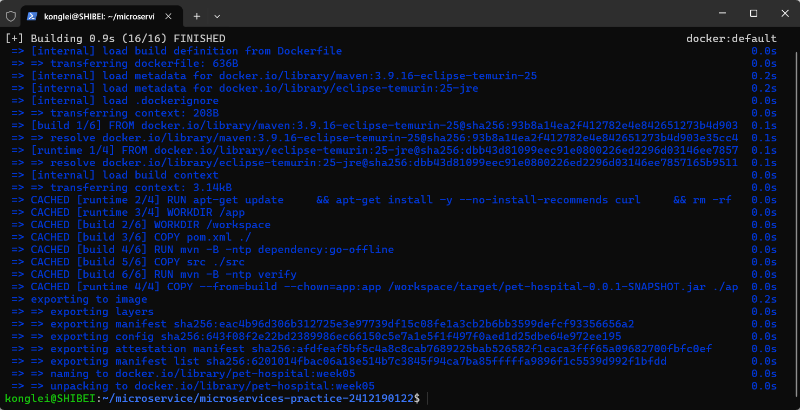
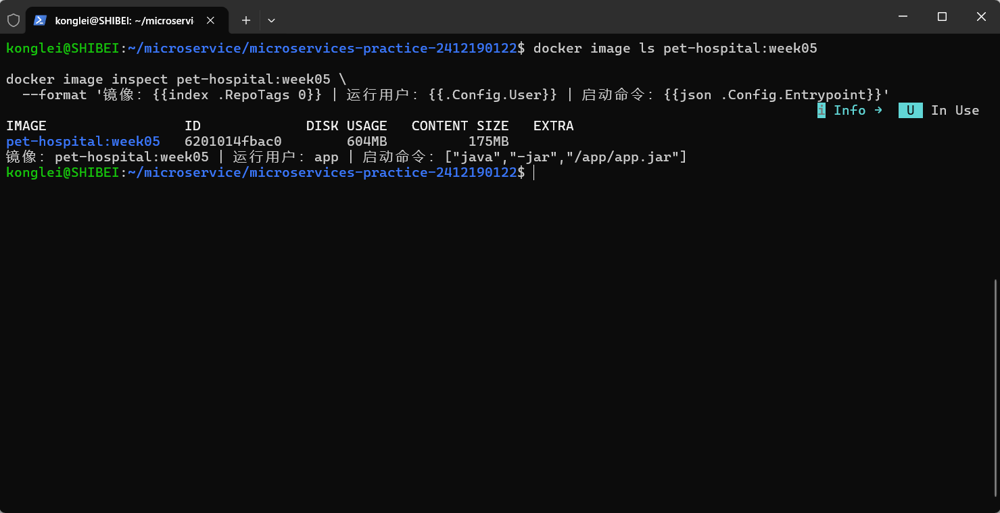
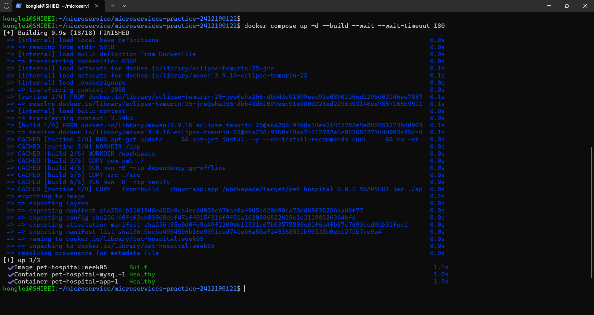
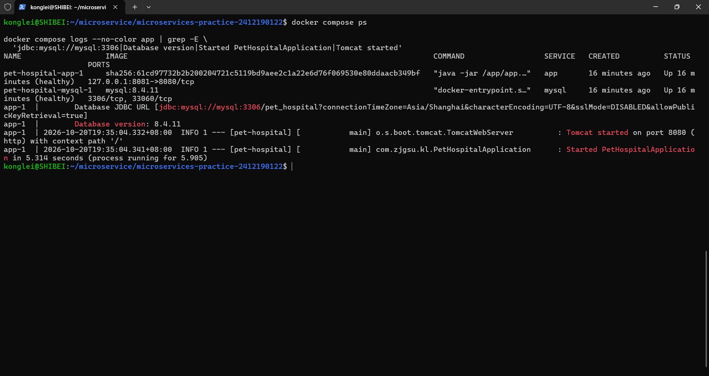
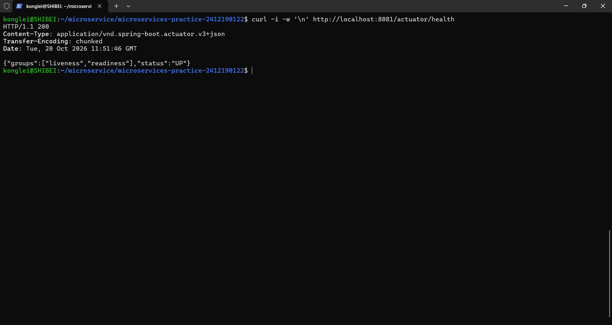
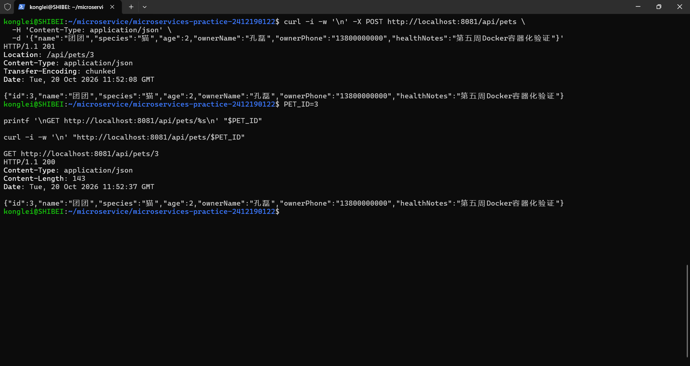
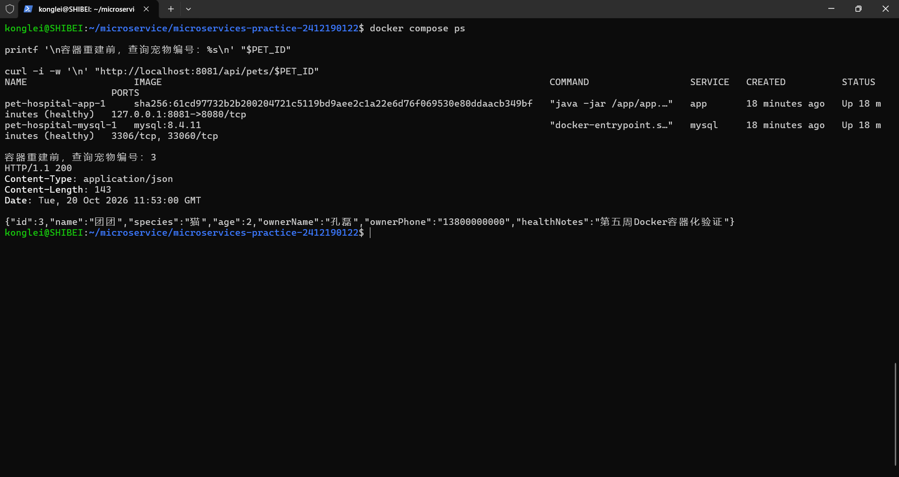
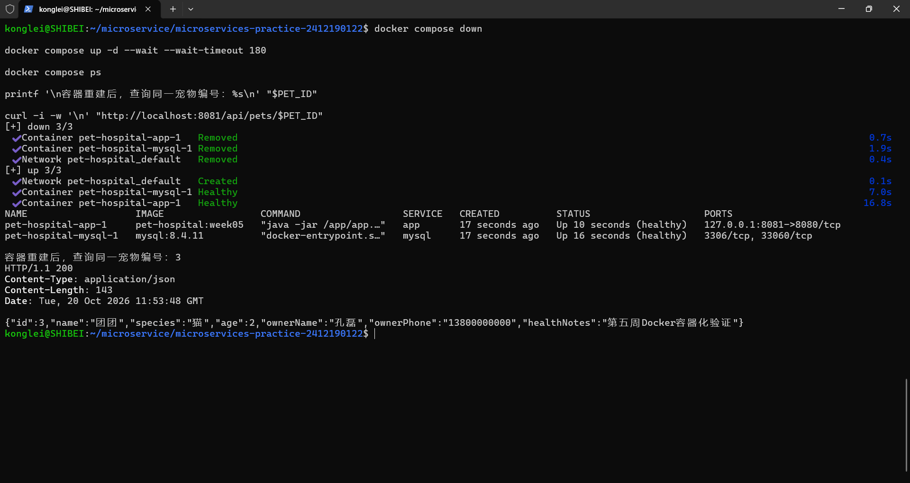

# 第 05 周作业记录

## 选题与实现范围

沿用第四周的宠物医院管理系统和原有 `monolith/` Spring Boot 单体工程，本周将应用与 MySQL 数据库容器化，实现镜像构建、Compose 一键启动、业务 API 验证和容器重建后的数据持久化验证。

本周不新增业务模型，不改变原有 Controller、Service 和 Repository 分层，也不进行微服务拆分。继续保留宠物、医生及就诊预约功能，Java 基础包仍为 `com.zjgsu.kl`。

`monolith/Dockerfile`、`monolith/.dockerignore` 位于单体工程目录；`compose.yaml`、`.env.example` 和环境变量忽略规则位于仓库根目录，应用构建上下文为 `./monolith`。以下 Docker 与 curl 命令均在 WSL 或 Linux 的仓库根目录执行。

## Dockerfile 与镜像构建

### 实现思路

采用多阶段 Dockerfile。构建阶段基于 `maven:3.9.16-eclipse-temurin-25`，先复制 `pom.xml` 并下载依赖，再复制源码，执行 `mvn -B -ntp verify`，完成自动化测试及 Spring Boot 可执行 JAR 打包。

运行阶段基于 `eclipse-temurin:25-jre`，只从构建阶段复制 `pet-hospital-0.0.1-SNAPSHOT.jar`，使用非 root 用户 `app` 运行 `java -jar /app/app.jar`。运行镜像不包含 Maven、Java 编译器或项目源码，curl 用于应用健康检查。

`.dockerignore` 仅放行 `pom.xml`、`src/`，排除本地 `target/`、IDE 配置、`application-local.properties`、环境变量密码文件及 `Zone.Identifier` 等无关内容，避免将本机构建产物或密码带入构建上下文。

### 构建与查看命令

```bash
docker build -t pet-hospital:week05 ./monolith

docker image ls pet-hospital:week05

docker image inspect pet-hospital:week05 \
  --format '镜像：{{index .RepoTags 0}} | 运行用户：{{.Config.User}} | 启动命令：{{json .Config.Entrypoint}}'
```

### 验证结果

2026 年 10 月 20 日完成镜像构建，镜像名称为 `pet-hospital:week05`。首次构建中的 35 项测试全部通过，失败、错误和跳过均为 0；后续重复构建复用缓存，最终显示 `FINISHED` 并成功导出镜像。

构建不依赖宿主机安装 Java、Maven 或预先生成 JAR。多阶段构建过程截图如下：



镜像查看结果显示标签为 `pet-hospital:week05`，运行用户为 `app`，入口命令为 `["java","-jar","/app/app.jar"]`，结果截图如下：



## Compose 编排与启动

### 实现思路

在仓库根目录编写 `compose.yaml`，配置 `app` 和 `mysql` 两个服务。应用从 `./monolith` 构建，数据库使用 `mysql:8.4.11`，不使用已废弃的 `version` 字段。

两个服务共享 Compose 默认网络，应用通过 `jdbc:mysql://mysql:3306/pet_hospital` 连接数据库，其中 `mysql` 为数据库服务名。MySQL 不对宿主机映射端口，与宿主机已有的 MySQL 相互独立。

应用容器内部监听 `8080`，默认映射到本机 `127.0.0.1:8081`。数据库目录 `/var/lib/mysql` 挂载到命名卷 `mysql_data`，当前实际卷名为 `pet-hospital_mysql_data`。

数据库健康检查通过应用数据库账号执行 `SELECT 1`，应用通过 `depends_on` 的 `service_healthy` 条件等待数据库健康后再启动。应用自身通过 `/actuator/health` 检查运行状态。

### 环境变量配置

首次配置时复制模板；已有 `.env` 不覆盖：

```bash
test -f .env || cp .env.example .env
```

复制后设置本机数据库密码。模板与连接关系如下：

| 配置项 | 模板值或作用 |
| --- | --- |
| `APP_PORT` | `8081`，本机应用访问端口 |
| `MYSQL_DATABASE` | `pet_hospital`，初始化业务数据库 |
| `MYSQL_USER` | `pet_hospital`，应用使用的数据库账号 |
| `MYSQL_PASSWORD` | 应用数据库密码，同时注入应用 `DB_PASSWORD` |
| `MYSQL_ROOT_PASSWORD` | MySQL 管理员密码，不用于应用连接 |
| 应用 `DB_URL` | 使用 `mysql:3306` 和 `MYSQL_DATABASE` 组装连接地址 |
| 应用 `DB_USERNAME` | 由 `MYSQL_USER` 提供 |

实际 `.env` 已加入 Git 忽略规则，`.env.example` 只保留配置示例，不包含真实密码。MySQL 账号和数据库的初始化仅在空数据卷上执行，已有卷应继续使用与数据库一致的账号密码。

### 启动与查看命令

```bash
docker compose up -d --build --wait --wait-timeout 180

docker compose ps

docker compose logs --no-color app | grep -E \
  'jdbc:mysql://mysql:3306|Database version|Started PetHospitalApplication|Tomcat started'
```

日常查看日志及停止服务：

```bash
docker compose logs --tail=100 app
docker compose logs --tail=100 mysql
docker compose down
```

### 验证结果

一条 Compose 命令完成镜像构建与服务启动，应用及 MySQL 健康检查均通过，启动结果截图如下：



`docker compose ps` 显示两个服务均为 `Up`、`healthy`，应用映射端口为 `8081->8080`。应用日志显示通过数据库服务名连接 MySQL，数据库版本为 `8.4.11`，并正常完成 Tomcat 与 Spring Boot 启动，结果截图如下：



## 个人业务 API 验证

### 验证思路

通过本机映射端口访问容器中的应用，先检查健康接口，再调用原有宠物档案创建与详情查询接口。验证请求地址、状态码、响应头和 JSON 内容，确认容器化后业务接口仍与原单体应用保持一致。

| 方法 | 路径 | 用途 | 本次结果 |
| --- | --- | --- | --- |
| GET | `/actuator/health` | 检查应用健康状态 | 200，`UP` |
| POST | `/api/pets` | 创建宠物档案 | 201，返回资源编号与 `Location` |
| GET | `/api/pets/{id}` | 查询已创建的宠物 | 200，字段与创建结果一致 |

### 健康接口

```bash
curl -i -w '\n' http://localhost:8081/actuator/health
```

返回 `200`，响应内容为：

```json
{"groups":["liveness","readiness"],"status":"UP"}
```

健康检查通过，运行结果截图如下：



### 宠物创建与查询

创建宠物档案：

```bash
curl -i -w '\n' -X POST http://localhost:8081/api/pets \
  -H 'Content-Type: application/json' \
  -d '{"name":"团团","species":"猫","age":2,"ownerName":"孔磊","ownerPhone":"13800000000","healthNotes":"第五周Docker容器化验证"}'
```

本次创建返回 `201`，响应头为 `Location: /api/pets/3`。响应 JSON 为：

```json
{
  "id": 3,
  "name": "团团",
  "species": "猫",
  "age": 2,
  "ownerName": "孔磊",
  "ownerPhone": "13800000000",
  "healthNotes": "第五周Docker容器化验证"
}
```

使用创建返回的实际编号查询，以下 `3` 为本次验证记录，重新执行时应以当次响应为准：

```bash
PET_ID=3
curl -i -w '\n' "http://localhost:8081/api/pets/$PET_ID"
```

详情查询返回 `200`，编号、名称、种类、年龄、主人信息与健康备注均与创建结果一致。创建和查询验证成功，运行结果截图如下：



## 数据持久化验证

### 实现思路

通过宠物业务接口创建数据后，先查询并记录结果，再执行 `docker compose down` 移除本项目应用容器、数据库容器和网络，随后重新启动并查询同一条记录。

验证过程中不使用 `docker compose down -v`。普通 `down` 保留 `mysql_data` 命名卷，新建的 MySQL 容器继续挂载原卷，因此数据库文件不会随容器移除而丢失。该验证区别于只重启应用进程，能够检查容器删除重建后的数据保存情况。

### 重建前查询

本次使用前述创建接口返回的宠物编号 `3`。下列命令在同一个终端执行：

```bash
PET_ID=3
docker compose ps
curl -i -w '\n' "http://localhost:8081/api/pets/$PET_ID"
```

应用和数据库运行正常，查询返回 `200`，宠物编号为 `3`、名称为“团团”、种类为“猫”、年龄为 `2`，健康备注为“第五周Docker容器化验证”。重建前结果截图如下：



### 删除并重新创建容器

```bash
docker compose down

docker compose up -d --wait --wait-timeout 180

docker compose ps

curl -i -w '\n' "http://localhost:8081/api/pets/$PET_ID"
```

`down` 成功移除两个容器及项目网络，`up` 重新创建服务并等待健康检查通过。重建后的应用和数据库均为 `healthy`，再次查询原宠物编号 `3` 返回 `200`，所有业务字段与重建前一致。重建后结果截图如下：



### 关键结论

本次删除并重新创建应用和数据库容器后，原宠物记录仍然存在，资源编号及关键字段没有变化，说明数据库已通过命名卷实现持久化。日常停止服务使用不带 `-v` 的 `docker compose down`，保留原数据卷与对应的环境配置。

## 本周完成汇总

- 完成 Maven 构建阶段与 JRE 运行阶段组成的多阶段镜像，镜像名为 `pet-hospital:week05`。
- 配置应用与 MySQL 8.4.11 的 Compose 编排、环境变量、共享网络、健康检查和命名卷。
- 通过映射端口验证健康检查、宠物创建与详情查询，分别返回预期的 `200`、`201`、`200`。
- 删除并重新创建容器后，同一宠物记录保持一致，完成数据持久化验证。
- 在根目录 [README](../../../README.md) 补充环境配置、构建启动、状态查看、停止命令及业务接口示例，本周八张运行截图均通过相对路径引用。
