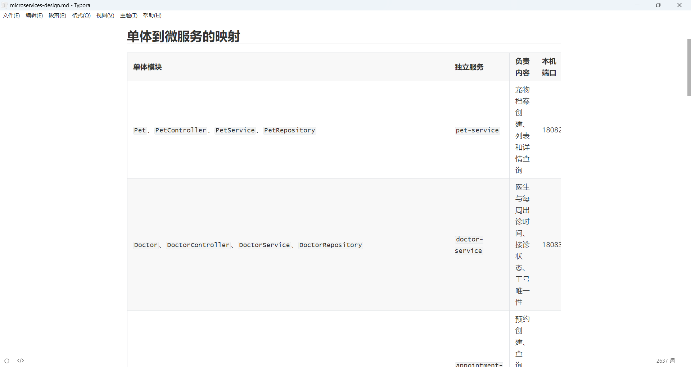
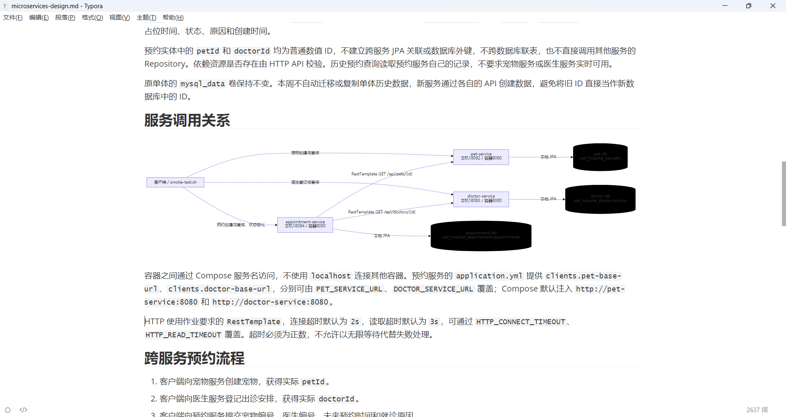
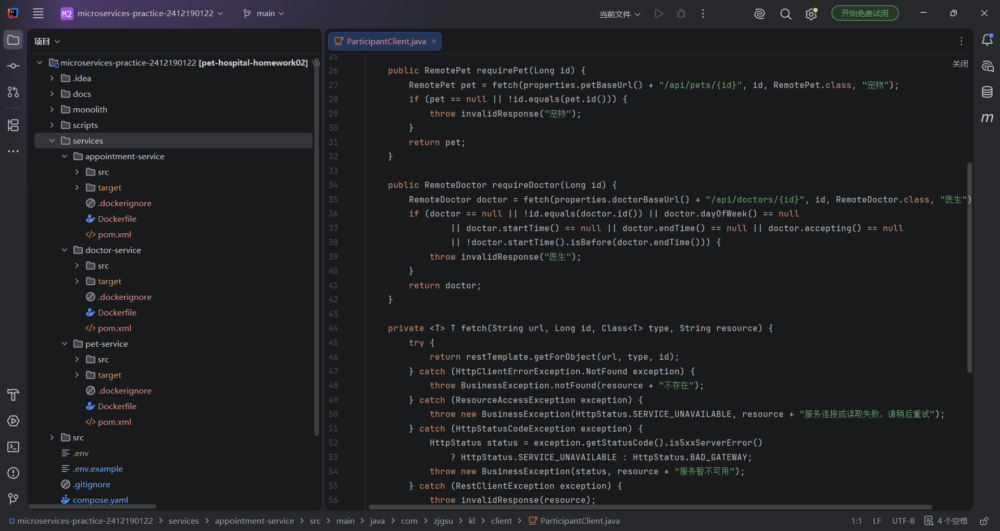
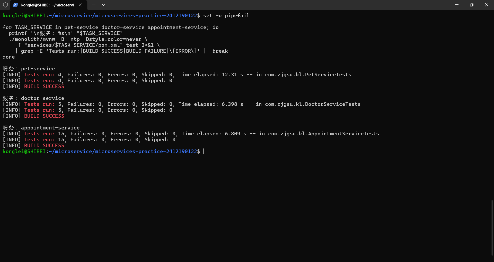
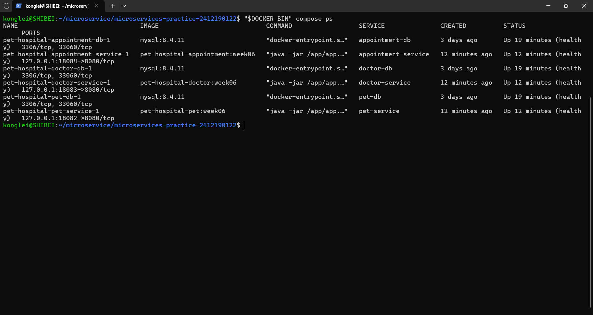
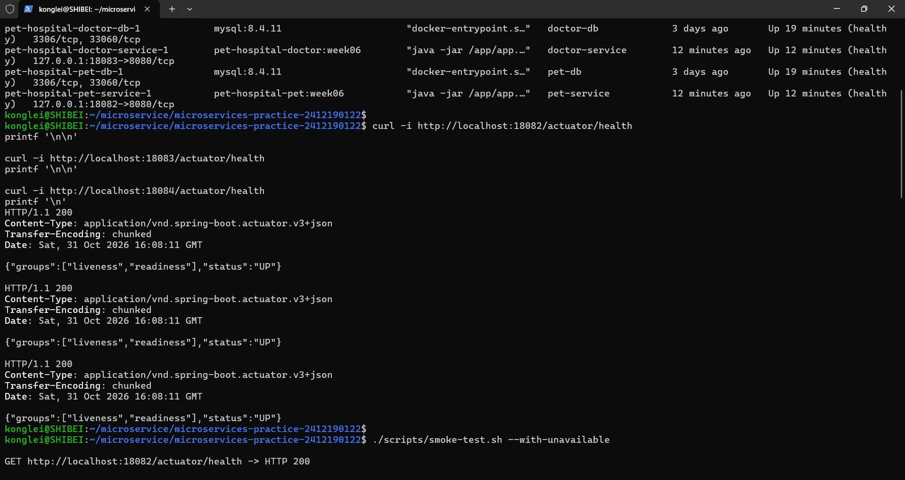
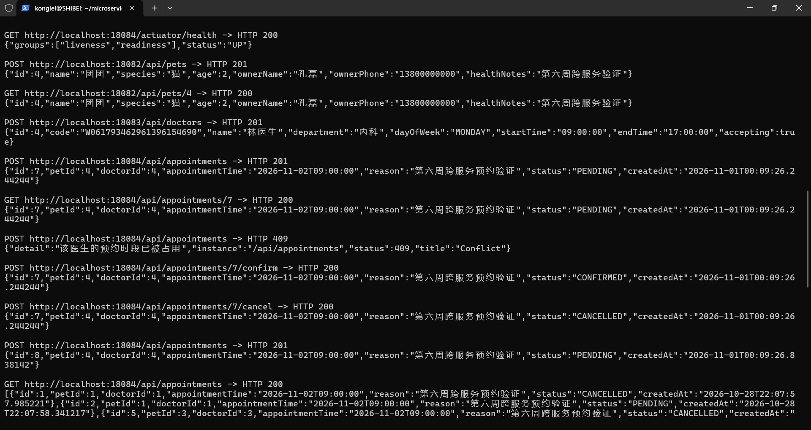
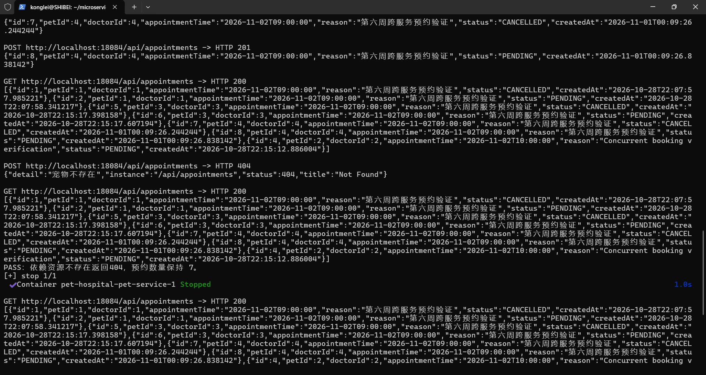
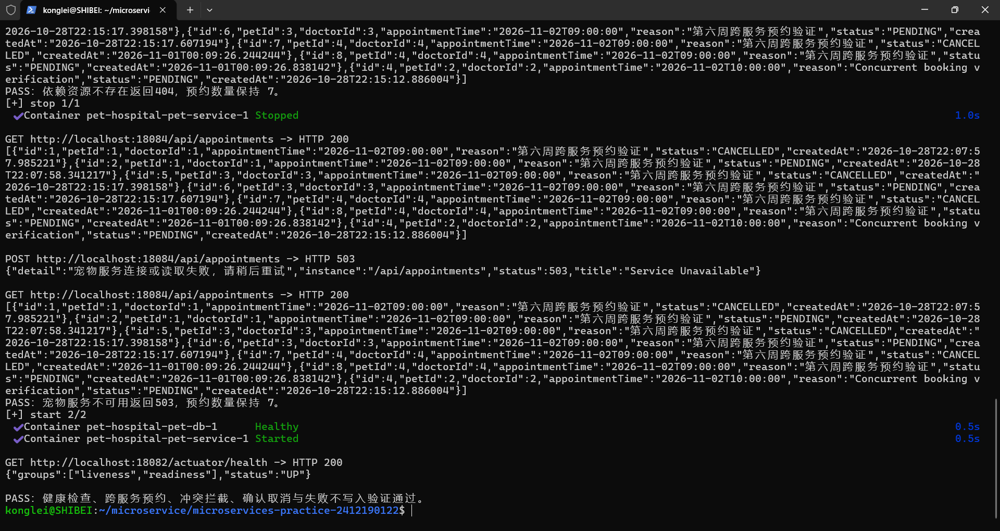

# 第 06 周作业记录

## 选题与实现范围

沿用第五周的宠物医院管理系统，在保留 `monolith/` 单体源码和原数据库卷的基础上，将宠物档案、医生排班和就诊预约拆分为三个独立 Spring Boot 服务，实现独立数据访问、基于 HTTP 的业务协作、本地容器编排及失败场景验证。

三个新工程统一放在仓库根目录 `services/` 下，Java 基础包继续使用 `com.zjgsu.kl`。各服务具有独立 `pom.xml`、`src/`、配置、Controller、Service、Repository 和测试，不依赖其他服务的业务 JAR。共享编排文件位于根目录 `compose.yaml`，验证脚本位于 `scripts/smoke-test.sh`。

本周继续实现已有的宠物就诊预约流程，不新增主人账户、登录权限、电子病历或收费功能。原单体作为历史版本保留，不将其改名或覆盖为微服务，也不自动迁移原单体数据。以下运行命令均在 WSL 或 Linux 的仓库根目录执行。

## 服务拆分设计

### 实现思路

按照已有业务职责拆分服务：宠物服务管理宠物档案和当前简化的主人信息，医生服务管理医生及每周出诊安排，预约服务处理预约创建、查询、冲突校验和状态变化。现阶段没有独立账户模型，因此使用已有医生业务作为第三个服务，保持拆分范围与已完成的功能一致。

| 服务 | 负责内容 | 本机端口 |
| --- | --- | --- |
| `pet-service` | 宠物档案创建、列表和详情查询 | 18082 |
| `doctor-service` | 医生登记、出诊时间、接诊状态和工号唯一性 | 18083 |
| `appointment-service` | 预约创建、查询、时段冲突和状态流转 | 18084 |

每个服务只读写自己的数据库。预约中的 `petId`、`doctorId` 为普通数值 ID，不建立跨服务 JPA 关联或数据库外键，不跨库联表，也不直接调用其他服务的 Repository。

| 服务 | 独立数据库 | 应用账号 | 拥有的数据表 |
| --- | --- | --- | --- |
| `pet-service` | `pet_hospital_pet` | `pet_user` | `pets` |
| `doctor-service` | `pet_hospital_doctor` | `doctor_user` | `doctors` |
| `appointment-service` | `pet_hospital_appointment` | `appointment_user` | `appointments` |

预约创建时，预约服务通过 HTTP 查询宠物是否存在及医生出诊信息，完成业务校验后才保存本地预约。历史预约查询只读取预约数据库，因此依赖服务暂时不可用时，仍能查看已有预约。

完整拆分映射、数据库归属、调用关系及 Mermaid 架构图记录在 [微服务拆分设计](../../microservices-design.md)。

### 验证结果

已完成三个服务的职责划分和数据归属设计，原有单体工程继续保留，服务拆分设计截图如下：



架构图展示客户端、三个业务服务和三个独立数据库的关系。预约服务通过 RestTemplate 调用宠物服务和医生服务，各服务通过本地 JPA 访问自身数据库，架构图截图如下：



## 代码拆分

### 实现思路

三个服务分别建立独立 Spring Boot 工程，目录结构如下：

```text
services/
├── pet-service/
│   ├── pom.xml
│   ├── Dockerfile
│   ├── .dockerignore
│   └── src/
├── doctor-service/
│   ├── pom.xml
│   ├── Dockerfile
│   ├── .dockerignore
│   └── src/
└── appointment-service/
    ├── pom.xml
    ├── Dockerfile
    ├── .dockerignore
    └── src/
```

Controller 负责 HTTP 输入输出，DTO 承载并校验请求，Service 实现业务判断，Repository 访问各自数据库。宠物、医生和预约均使用独立配置，不导入其他服务的实体或 Repository。

预约服务在 `ParticipantClient` 中使用 `RestTemplate.getForObject(...)` 调用 `/api/pets/{id}` 和 `/api/doctors/{id}`。服务地址写在 `application.yml` 中，可通过环境变量覆盖；默认连接超时为 `2s`，读取超时为 `3s`。

| 配置项 | Compose 中的默认值 |
| --- | --- |
| `PET_SERVICE_URL` | `http://pet-service:8080` |
| `DOCTOR_SERVICE_URL` | `http://doctor-service:8080` |
| `HTTP_CONNECT_TIMEOUT` | `2s` |
| `HTTP_READ_TIMEOUT` | `3s` |

远端宠物不存在或医生不存在时返回 `404`；连接失败、读取超时或依赖服务返回 5xx 时返回 `503`；远端响应无效时返回 `502`。这些错误在本地写入前终止预约，不使用默认数据绕过校验。

预约服务继续检查医生接诊状态、出诊星期与时间、未来预约时间、半小时对齐和时段冲突。预约表保留医生与占位时间、宠物与占位时间的联合唯一约束；取消预约保留历史记录并释放时段。

### 独立测试命令

本机构建目标为 Java 25，WSL 开发环境使用 JDK 26。测试通过已有 Maven Wrapper 执行，Wrapper 只作为构建工具复用，三个服务不依赖单体业务代码：

```bash
./monolith/mvnw -B -ntp -f services/pet-service/pom.xml test

./monolith/mvnw -B -ntp -f services/doctor-service/pom.xml test

./monolith/mvnw -B -ntp -f services/appointment-service/pom.xml test
```

各服务测试使用独立 H2 内存数据库，自动准备数据，无需预先启动 MySQL 或其他服务。预约服务使用 `MockRestServiceServer` 验证 RestTemplate 请求路径、依赖错误、超时及失败不写入；真实服务间 HTTP 通信在容器联调中验证。

### 验证结果

三个工程均有独立配置、Controller、Service、Repository 和测试。工程结构与 HTTP 调用代码截图如下：



独立测试全部通过，结果如下：

| 服务 | 测试数量 | 失败 | 错误 | 跳过 | 构建结果 |
| --- | --- | --- | --- | --- | --- |
| `pet-service` | 4 | 0 | 0 | 0 | BUILD SUCCESS |
| `doctor-service` | 5 | 0 | 0 | 0 | BUILD SUCCESS |
| `appointment-service` | 15 | 0 | 0 | 0 | BUILD SUCCESS |
| 合计 | 24 | 0 | 0 | 0 | 全部通过 |

测试覆盖健康接口、各自数据库读写、参数校验、预约业务规则、跨服务调用及依赖失败不写入。运行测试成功，运行结果截图如下：



## 本地编排

### 实现思路

更新根目录 `compose.yaml`，默认启动三个应用和三个 MySQL 8.4.11 数据库。各应用分别从对应的 `services/` 子目录构建，构建阶段使用 Maven 完成测试和打包，运行阶段使用 JRE 运行可执行 JAR。

| 应用服务 | 数据库服务名 | 应用镜像 | 数据卷 |
| --- | --- | --- | --- |
| `pet-service` | `pet-db` | `pet-hospital-pet:week06` | `pet_data` |
| `doctor-service` | `doctor-db` | `pet-hospital-doctor:week06` | `doctor_data` |
| `appointment-service` | `appointment-db` | `pet-hospital-appointment:week06` | `appointment_data` |

应用容器内部均监听 `8080`，本机映射端口为 `18082～18084`。容器通过 Compose 服务名连接数据库和其他应用，不使用 `localhost` 访问其他容器。三个 MySQL 容器均不向宿主机映射端口，应用只使用自身业务数据库账号。

数据库目录 `/var/lib/mysql` 分别挂载独立命名卷，容器重建时继续使用原卷。MySQL 通过业务账号执行 `SELECT 1` 检查健康，应用等待自身数据库健康后启动，预约服务同时等待宠物和医生服务健康。

原单体应用和数据库放入 `monolith` profile，不属于本周默认启动范围，原 `mysql_data` 数据卷继续保留。

### 环境配置与启动命令

运行前启动 Docker Desktop 的 Linux 容器引擎。WSL 已启用 Docker 集成时使用 `docker`；可访问 Windows Docker CLI 时也可使用 `docker.exe`。容器构建不要求宿主机安装 Java、Maven 或 MySQL。

首次配置复制模板，已有 `.env` 不覆盖：

```bash
test -f .env || cp .env.example .env
```

根据 `.env.example` 补齐三个服务的数据库名称、账号、独立密码和端口配置。已有数据库卷应继续使用与其匹配的凭据，原单体的账号密码保持不变。实际 `.env` 已加入忽略规则，模板只保留配置示例。

从仓库根目录一键构建并启动：

```bash
export DOCKER_BIN=docker
if ! docker compose version >/dev/null 2>&1; then
  export DOCKER_BIN=docker.exe
fi

"$DOCKER_BIN" compose up -d --build --wait --wait-timeout 240

"$DOCKER_BIN" compose ps
```

查看预约服务日志与停止服务：

```bash
"$DOCKER_BIN" compose logs --tail=100 appointment-service

"$DOCKER_BIN" compose stop
```

移除容器时使用 `compose down`，不附加 `-v`，保留数据库命名卷。

### 验证结果

三个应用与三个 MySQL 数据库全部启动成功，`compose ps` 显示六个容器均为 `Up`、`healthy`。应用端口分别映射为 `18082->8080`、`18083->8080`、`18084->8080`，数据库仅在 Compose 网络中开放。运行结果截图如下：



## 验证

### 验证思路与脚本入口

从仓库根目录运行 [冒烟测试脚本](../../../scripts/smoke-test.sh)，先检查三个服务的健康接口，再创建宠物、医生和预约，验证查询、冲突、确认、取消及取消后重新预约。工号使用时间生成，预约时间自动选择未来的周一，资源编号使用创建响应中的实际值，可重复运行。

```bash
./scripts/smoke-test.sh
```

完整验证额外包含真实依赖停机：

```bash
./scripts/smoke-test.sh --with-unavailable
```

附加模式暂时停止本项目宠物服务，检查预约创建返回 `503`、本地预约数量不变，随后恢复服务并等待健康。脚本异常退出时也会尝试恢复已停止的依赖，不停止医生、预约或数据库服务。

以下业务结果来自 2026 年 11 月 1 日的截图验证。已有历史数据继续保留，本次宠物和医生编号均为 `4`，首次预约编号为 `7`，取消后重新预约编号为 `8`。这些编号仅用于记录本次结果，重复运行以当次响应为准。

### 三个服务的健康检查

```bash
curl -i http://localhost:18082/actuator/health

curl -i http://localhost:18083/actuator/health

curl -i http://localhost:18084/actuator/health
```

三个请求均返回 `200`，响应中的 `status` 均为 `UP`。健康检查成功，运行结果截图如下：



### 跨服务预约创建与查询

脚本先通过宠物服务创建“团团”的档案，种类为“猫”、年龄为 `2`，主人姓名为“孔磊”，返回 `petId=4`。随后通过医生服务登记内科医生，配置周一 `09:00～17:00` 出诊并接诊，返回 `doctorId=4`。

向预约服务 `POST http://localhost:18084/api/appointments` 提交：

```json
{
  "petId": 4,
  "doctorId": 4,
  "appointmentTime": "2026-11-02T09:00:00",
  "reason": "第六周跨服务预约验证"
}
```

预约服务先通过 HTTP 查询宠物和医生，再检查排班、时间及本地占位，成功后返回 `201`。首次预约的主要响应字段为：

```json
{
  "id": 7,
  "petId": 4,
  "doctorId": 4,
  "appointmentTime": "2026-11-02T09:00:00",
  "reason": "第六周跨服务预约验证",
  "status": "PENDING"
}
```

| 实际请求 | 状态码 | 结果与数据变化 |
| --- | --- | --- |
| `POST :18082/api/pets` | 201 | 新增宠物 `4` |
| `GET :18082/api/pets/4` | 200 | 查询到刚创建的宠物 |
| `POST :18083/api/doctors` | 201 | 新增医生 `4` |
| `POST :18084/api/appointments` | 201 | 新增预约 `7`，状态为 `PENDING` |
| `GET :18084/api/appointments/7` | 200 | 返回原预约及宠物、医生编号 |
| 重复提交同一预约 | 409 | 返回该医生的预约时段已被占用，不新增 |
| `POST :18084/api/appointments/7/confirm` | 200 | 预约 `7` 变为 `CONFIRMED` |
| `POST :18084/api/appointments/7/cancel` | 200 | 预约 `7` 变为 `CANCELLED`，保留历史并释放时段 |
| 再次提交相同时段预约 | 201 | 新增预约 `8`，状态为 `PENDING` |

本次流程新增两条预约，包含原有历史数据时本地预约总数为 `7`。跨服务预约、查询及状态变化验证成功，运行结果截图如下：



### 依赖资源不存在

脚本将请求中的 `petId` 改为不存在的 `9223372036854775807`，保留实际医生和预约时间，再向预约服务提交。宠物服务返回不存在，预约服务向客户端返回 `404`，错误说明为“宠物不存在”。

失败前后分别查询 `GET http://localhost:18084/api/appointments`，均返回 `200`，预约数量保持为 `7`。脚本比较前后数量并输出通过结论，证明未继续写入本地数据库。运行结果截图如下：



### 依赖服务不可用

脚本停止 `pet-service` 后再次提交预约，预约服务返回 `503`，错误说明为“宠物服务连接或读取失败，请稍后重试”。此时预约列表仍返回 `200`，失败前后数量均为 `7`，已有历史记录仍可独立查询。

脚本随后恢复宠物服务，其健康接口重新返回 `200` 和 `UP`，最后输出完整验证通过结论。运行结果截图如下：



### 本地事务与关键结论

| 验证场景 | 结果 | 本地数据变化 |
| --- | --- | --- |
| 正常跨服务预约 | 201，查询为 200 | 新增预约 |
| 同一医生时段重复预约 | 409 | 不新增 |
| 取消后重新预约 | 200 / 201 | 原记录保留，新增一条预约 |
| 依赖宠物不存在 | 404 | 数量由 7 保持为 7 |
| 宠物服务不可用 | 503 | 数量由 7 保持为 7 |
| 依赖恢复 | 200，UP | 历史预约仍可查询 |

远端查询成功与本地预约保存不属于同一个原子事务。两次 HTTP 校验完成后，本地仍可能因并发占位、唯一约束、数据库故障或进程中断而保存失败，存在“远端成功、本地失败”的窗口。远端接口本周只读取数据，不修改远端资源，因此本地失败不会产生需要回滚的远端写入；是否预约成功以本地保存和最终响应为准。

本周完成顺序 HTTP 调用、超时和基本失败处理，不实现跨服务原子事务、自动补偿或消息机制。验证表明三个服务可以独立持久化并通过 HTTP 协作，依赖缺失或停机时返回明确错误，不会跳过检查继续写入预约。

## 本周完成汇总

- 完成宠物档案、医生排班、就诊预约三个服务的边界设计、数据归属和 Mermaid 架构图。
- 新建三个独立 Spring Boot 工程，保留原 `monolith/`，实现基于 RestTemplate 的跨服务预约校验。
- 使用 Compose 启动三个应用和三个独立 MySQL 数据库，配置服务名通信、账号隔离、健康检查和命名卷。
- 完成 24 项独立测试，三个服务的健康接口、跨服务预约和 404、503 失败不写入验证均通过。
- 根目录 [README](../../../README.md) 提供启动、测试和验证命令，本周九张截图均使用相对路径引用。

