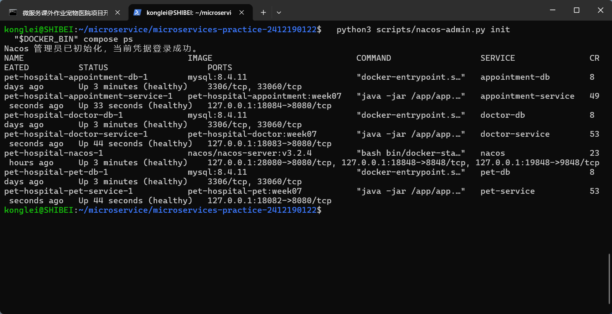
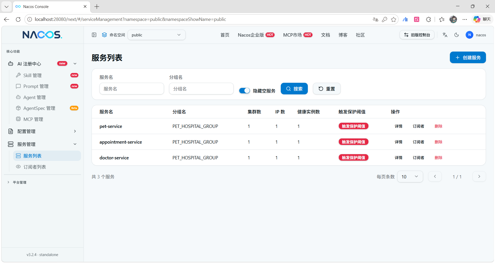
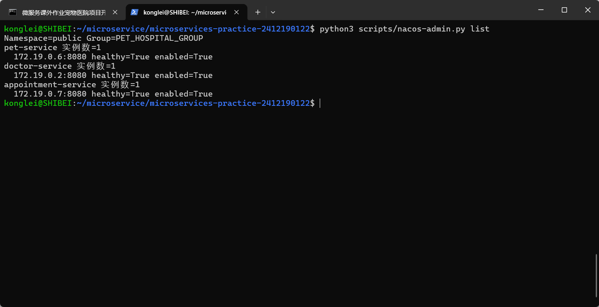
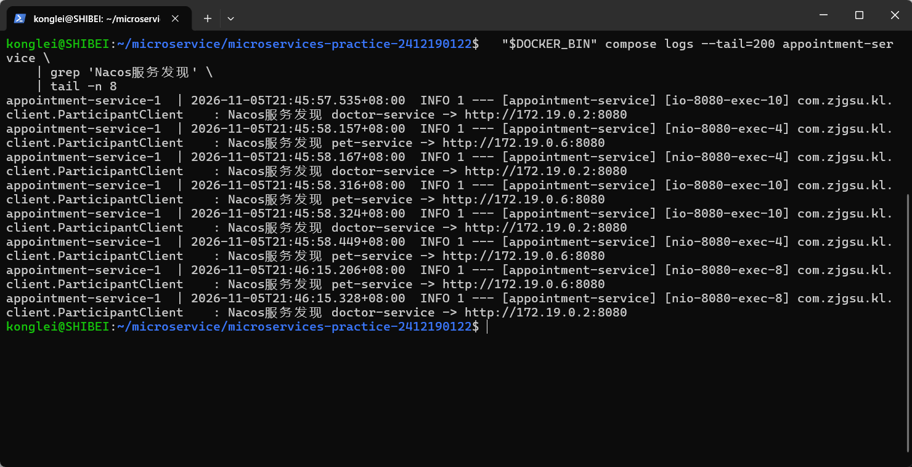
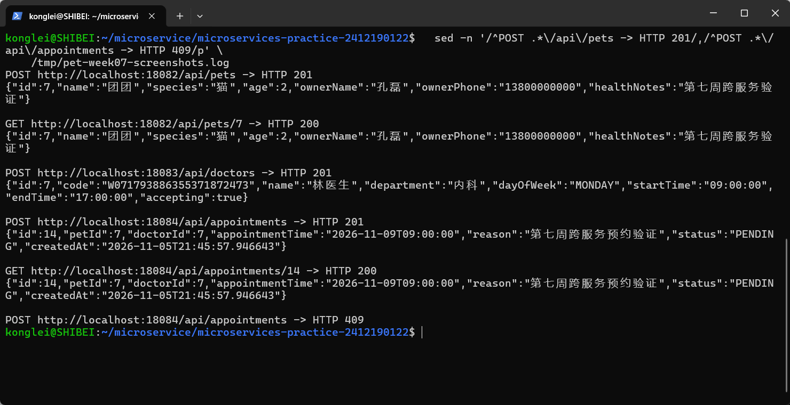
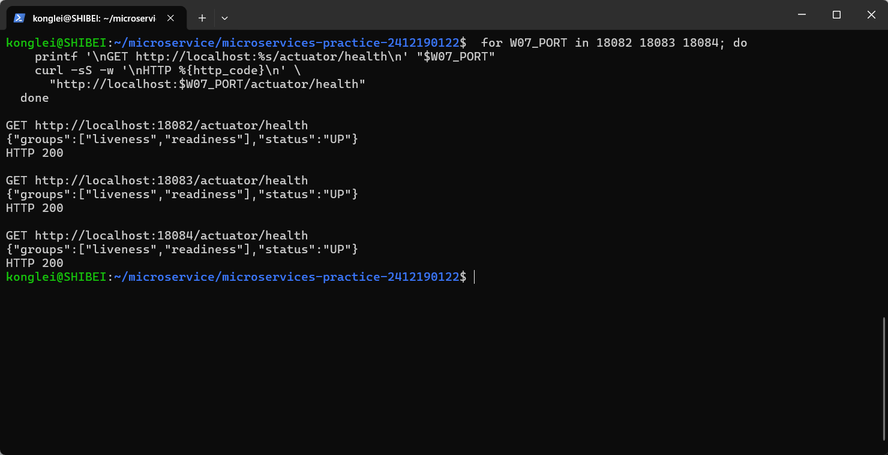
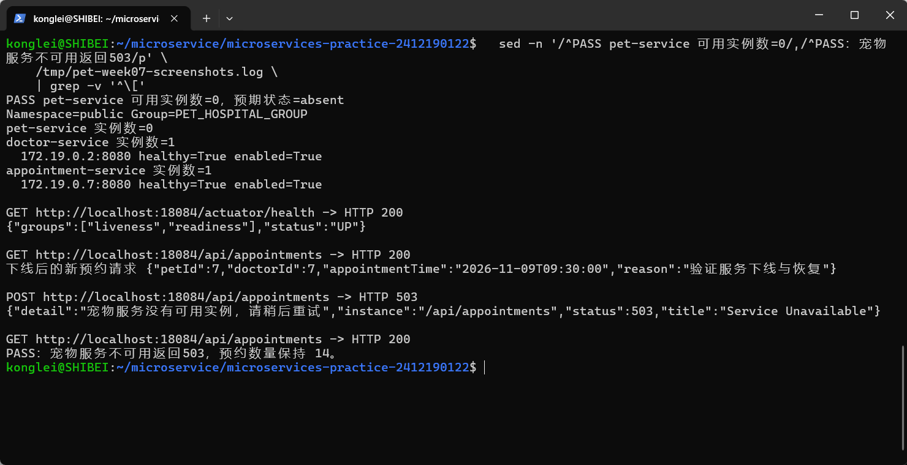
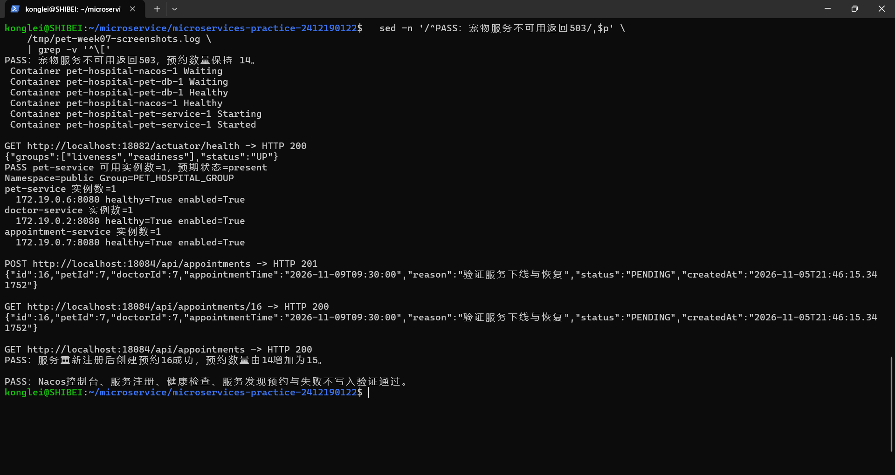
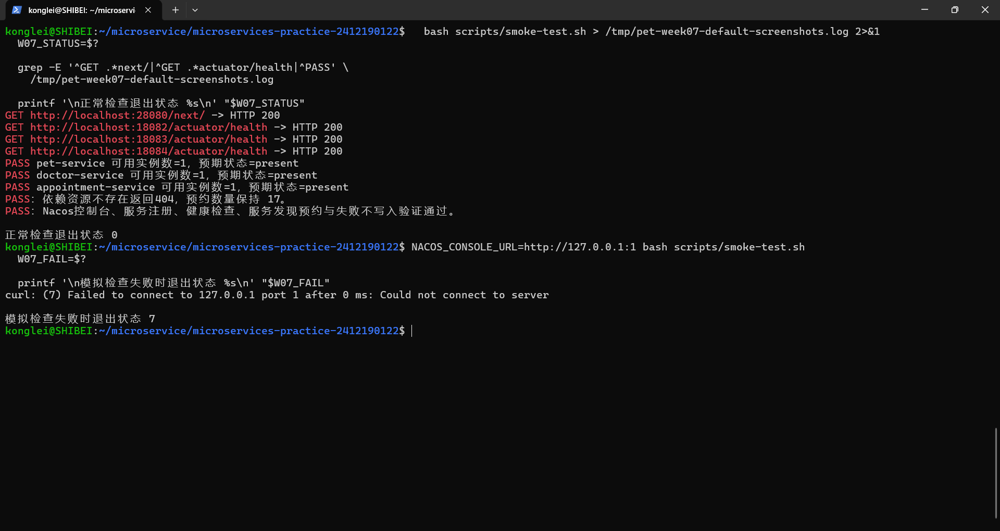
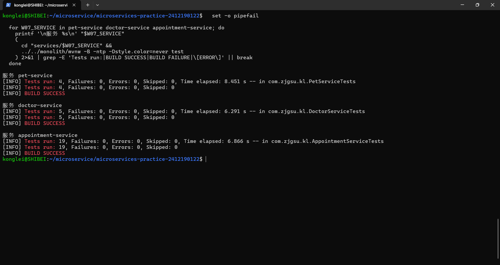

# 第 07 周作业记录

## 选题与实现范围

沿用第六周宠物医院管理系统的三个微服务，本周接入 Nacos 3.2.4，将预约创建中的宠物和医生校验改为服务发现调用，完成注册、实例寻址、正常预约、依赖下线失败及恢复后的验证。

本周开发继续使用 `services/pet-service/`、`services/doctor-service/` 和 `services/appointment-service/`，Java 基础包为 `com.zjgsu.kl`。各服务分别管理宠物、医生及预约数据，预约通过参与方 ID 与 HTTP 校验完成业务协作。服务边界见 [微服务拆分设计](../../microservices-design.md)。

Nacos 编排位于根目录 `compose.yaml`，注册中心管理脚本为 `scripts/nacos-admin.py`，冒烟入口为 `scripts/smoke-test.sh`。以下命令均在 WSL 或 Linux 的仓库根目录执行。

## 部署 Nacos 并注册服务

### 实现思路

在 Compose 中加入 `nacos/nacos-server:v3.2.4`，使用 standalone 模式，数据目录 `/home/nacos/data` 挂载到 `nacos_data` 命名卷。配置 Token 密钥、Server identity、客户端鉴权、管理接口鉴权和控制台鉴权。

三个业务服务通过 Spring Cloud `2025.1.0` 和 Spring Cloud Alibaba `2025.1.0.0` BOM 管理 Discovery Starter 及传递的 Nacos Client 版本，基础工程为 Spring Boot `4.0.8`。三个服务按各自 `spring.application.name` 注册。

| 服务名 | 本机业务端口 | 注册实例端口 | 数据库 |
| --- | --- | --- | --- |
| `pet-service` | 18082 | 8080 | `pet_hospital_pet` |
| `doctor-service` | 18083 | 8080 | `pet_hospital_doctor` |
| `appointment-service` | 18084 | 8080 | `pet_hospital_appointment` |

Nacos 的三类端口分别映射，控制台选用 `28080`，避开本机课内项目已占用的 `18080`。

| 用途 | 本机端口 | 容器端口 |
| --- | --- | --- |
| 控制台 HTTP | 28080 | 8080 |
| Server HTTP | 18848 | 8848 |
| SDK gRPC | 19848 | 9848 |

### 初始化与启动命令

选择可用的 Docker CLI，首次配置时从模板建立本地环境文件。

```bash
export DOCKER_BIN=docker
if ! docker compose version >/dev/null 2>&1; then
  export DOCKER_BIN=docker.exe
fi

test -f .env || cp .env.example .env
```

按模板设置数据库及 Nacos 凭据。`NACOS_AUTH_TOKEN` 使用 Base64 编码的随机密钥，解码后至少 32 字节，Server identity 的 Key 和 Value 使用独立非空值。实际密码和密钥存放在已被 Git 忽略的本地 `.env`，`.env.example` 提供占位模板。

先启动 Nacos 并初始化管理员，再启动业务服务和数据库。

```bash
"$DOCKER_BIN" compose up -d --wait --wait-timeout 180 nacos

python3 scripts/nacos-admin.py init

"$DOCKER_BIN" compose up -d --build --wait --wait-timeout 240

"$DOCKER_BIN" compose ps
```

初始化脚本从 Compose 环境读取管理员凭据，首次设置密码并验证登录。再次执行时验证已有凭据。管理员数据随 `nacos_data` 卷保存。

控制台地址为 `http://localhost:28080/`，根地址跳转到 `/next/`。使用本地账号登录，选择 `public` 命名空间及 `PET_HOSPITAL_GROUP` 分组查看服务。

### 验证结果

Nacos 管理员凭据登录成功，注册中心、三个应用和三个 MySQL 数据库共七个容器均为 `healthy`。初始化与容器运行结果见下图。



控制台显示 `pet-service`、`doctor-service`、`appointment-service` 三个业务服务，各有一个健康实例，分组均为 `PET_HOSPITAL_GROUP`。



执行注册列表查询命令，核对服务名、分组和实例地址。

```bash
python3 scripts/nacos-admin.py list
```

本次实例地址分别为 `172.19.0.6:8080`、`172.19.0.2:8080`、`172.19.0.7:8080`，均为健康且启用状态。实例 IP 随容器网络分配，以当次注册结果为准。



## 配置隔离并完成服务发现调用

### 实现思路

三个服务通过环境变量读取 Nacos 地址、账号、密码、命名空间与分组。Compose 中 `NACOS_SERVER_ADDR` 为 `nacos:8848`，`NACOS_NAMESPACE` 留空对应默认 `public` 命名空间，`NACOS_GROUP` 为 `PET_HOSPITAL_GROUP`。

预约服务每次校验参与方时调用 `DiscoveryClient.getInstances("pet-service")` 或 `DiscoveryClient.getInstances("doctor-service")`，选取一个当前已知实例，使用其 URI 与原业务路径组合后，通过 RestTemplate 发起 GET 请求。HTTP 连接和读取超时分别为 `2s`、`3s`。

| 发现的服务 | HTTP 业务路径 | 用途 |
| --- | --- | --- |
| `pet-service` | `/api/pets/{id}` | 确认宠物存在 |
| `doctor-service` | `/api/doctors/{id}` | 获取医生接诊状态和出诊安排 |

实例列表为空时返回 `503`，连接失败或读取超时也返回 `503`。宠物或医生资源不存在时返回 `404`，依赖响应无效时返回 `502`。预约保存位于远端校验和本地业务规则校验之后，失败请求在写入前终止。

### 运行命令

运行完整业务流程并查看预约服务实际选取的实例。

```bash
bash scripts/smoke-test.sh

"$DOCKER_BIN" compose logs --tail=100 appointment-service | grep 'Nacos服务发现'
```

### 验证结果

预约服务日志显示通过发现结果访问 `http://172.19.0.6:8080` 和 `http://172.19.0.2:8080`，与注册实例地址一致。



2026 年 11 月 5 日的截图验证中，先创建宠物“团团”和内科医生，获得 `petId=7`、`doctorId=7`。医生周一 `09:00～17:00` 接诊，提交预约请求。

```json
{
  "petId": 7,
  "doctorId": 7,
  "appointmentTime": "2026-11-09T09:00:00",
  "reason": "第七周跨服务预约验证"
}
```

| 实际请求 | 状态码 | 实际结果 |
| --- | --- | --- |
| `POST :18082/api/pets` | 201 | 新增宠物 `7` |
| `GET :18082/api/pets/7` | 200 | 查询到该宠物 |
| `POST :18083/api/doctors` | 201 | 新增医生 `7` |
| `POST :18084/api/appointments` | 201 | 新增预约 `14`，状态为 `PENDING` |
| `GET :18084/api/appointments/14` | 200 | 资源编号、参与方和预约时间一致 |
| 再次提交同一时段预约 | 409 | 时段冲突，预约创建被拒绝 |

创建和查询成功，业务请求及响应见下图。本节编号仅记录本次验证，重复执行时使用当次响应的实际编号。



## 验证健康状态、下线与恢复

### 健康检查

分别访问三个应用的 Actuator 健康接口。

```bash
curl -i http://localhost:18082/actuator/health
curl -i http://localhost:18083/actuator/health
curl -i http://localhost:18084/actuator/health
```

三个接口均返回 `200`，响应中的 `status` 均为 `UP`，健康检查结果见下图。



### 停止服务并检查失败结果

执行完整下线与恢复验证。

```bash
bash scripts/smoke-test.sh --with-unavailable
```

脚本在正常预约流程结束后执行以下停止和实例检查操作。

```bash
"$DOCKER_BIN" compose stop pet-service
python3 scripts/nacos-admin.py wait --service pet-service --state absent
python3 scripts/nacos-admin.py list
```

宠物服务可用实例数变为 `0`，医生和预约服务仍各有一个健康实例。脚本选取新的有效时段 `09:30`，提交以下预约参数。

```json
{
  "petId": 7,
  "doctorId": 7,
  "appointmentTime": "2026-11-09T09:30:00",
  "reason": "验证服务下线与恢复"
}
```

创建返回 `503`，错误说明为“宠物服务没有可用实例，请稍后重试”。失败前后预约列表均可查询，总数量保持为 `14`，预约服务自身健康接口仍返回 `200` 和 `UP`。



### 恢复服务并重新预约

脚本启动宠物服务，等待应用健康和实例重新注册，再提交同一组 `09:30` 预约参数。相关恢复命令如下。

```bash
"$DOCKER_BIN" compose start pet-service
python3 scripts/nacos-admin.py wait --service pet-service
python3 scripts/nacos-admin.py list
```

宠物服务健康恢复为 `UP`，可用实例数恢复为 `1`。同一请求返回 `201`，生成预约 `16`，状态为 `PENDING`，详情查询返回 `200`。预约总数由 `14` 增加到 `15`，说明服务恢复后可重新完成业务操作。



### 三类状态与事务窗口

| 状态 | 表示的含义 | 本系统中的验证 |
| --- | --- | --- |
| SDK 连接存活 | 应用与 Nacos 之间的通信状态 | 预约服务在宠物下线期间仍能连接注册中心并获取实例列表 |
| 注册实例状态 | 注册中心当前保存的服务地址、健康和启用状态 | 宠物可用实例数经历 `1 → 0 → 1` |
| Actuator 应用健康 | HTTP 健康端点报告的应用及其健康组件状态 | 宠物下线时预约服务仍为 `UP`，但创建预约返回 `503` |

服务停止生命周期、SDK 连接与注册中心机制共同影响实例状态变化。Actuator 健康端点由应用健康组件处理，应用健康状态的变化与 Nacos 实例摘除之间需要相应的注册生命周期或健康检查机制衔接。

远端宠物和医生校验成功后，本地保存仍可能因时段冲突、数据库故障或进程中断而失败，存在“远端成功、本地失败”的窗口。远端校验属于读取操作，本地事务控制预约写入，最终业务结果以预约响应和数据库记录为准。

## 验证脚本

### 实现思路与运行命令

`scripts/smoke-test.sh` 从仓库根目录运行，读取 Compose 的实际映射端口，依次检查控制台最终 HTTP 页面、三个健康接口、三个注册服务及跨服务预约业务。默认模式还验证重复预约、确认取消、重新预约和依赖资源不存在的 `404` 响应。

`scripts/nacos-admin.py` 提供管理员初始化、实例列表和等待实例出现或消失的功能。认证信息从本地 Compose 环境读取，脚本输出服务名、分组、实例地址与验证结论。

检查正常退出状态。

```bash
bash scripts/smoke-test.sh
W07_STATUS=$?
printf '正常检查退出状态 %s\n' "$W07_STATUS"
```

将控制台地址临时指向无法连接的本机端口，验证失败退出状态。

```bash
NACOS_CONSOLE_URL=http://127.0.0.1:1 bash scripts/smoke-test.sh
W07_FAIL=$?
printf '模拟检查失败时退出状态 %s\n' "$W07_FAIL"
```

### 脚本验证结果

正常执行时，控制台 `http://localhost:28080/next/` 返回 `200`，三个健康接口均返回 `200`，三个服务均有可用注册实例。完整业务检查通过，退出状态为 `0`。

默认脚本的单独一轮运行中，依赖资源不存在返回 `404`，预约数量保持为 `17`。该轮运行晚于前述下线与恢复验证，新增了本轮测试记录。

模拟控制台连接失败时，curl 报告连接失败，脚本退出状态为 `7`。正常与失败退出结果见下图。



### 各服务独立测试

在仓库根目录进入对应服务目录执行测试。

```bash
(cd services/pet-service && ../../monolith/mvnw -B -ntp test)

(cd services/doctor-service && ../../monolith/mvnw -B -ntp test)

(cd services/appointment-service && ../../monolith/mvnw -B -ntp test)
```

测试配置关闭 Nacos Discovery 和自动注册，数据访问使用 H2。预约服务模拟 DiscoveryClient 和 HTTP 响应，覆盖每次操作重新寻址、实例为空、发现异常、远端错误、超时及原有预约业务规则。

| 服务 | 测试数量 | 失败 | 错误 | 跳过 | 构建结果 |
| --- | --- | --- | --- | --- | --- |
| `pet-service` | 4 | 0 | 0 | 0 | BUILD SUCCESS |
| `doctor-service` | 5 | 0 | 0 | 0 | BUILD SUCCESS |
| `appointment-service` | 19 | 0 | 0 | 0 | BUILD SUCCESS |
| 合计 | 28 | 0 | 0 | 0 | 全部通过 |

运行测试成功，测试结果见下图。



## 本周完成汇总

- 完成 Nacos 3.2.4 部署、鉴权、管理员初始化和三个业务服务的注册。
- 通过统一命名空间、分组及环境变量配置实现隔离，预约使用发现的实例 URI 发起真实 HTTP 请求。
- 验证正常预约、依赖下线返回 503 且数量保持一致、实例恢复后成功创建与查询。
- 验证默认脚本退出 0、检查失败退出非零，三个服务共 28 项独立测试通过。
- 启动、初始化、服务列表和测试命令见根目录 [README](../../../README.md)，本周十张截图通过相对路径引用。
