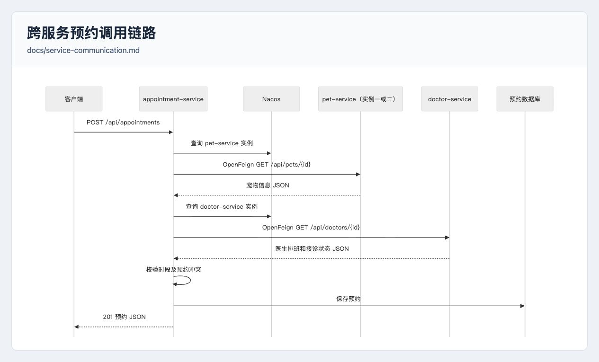
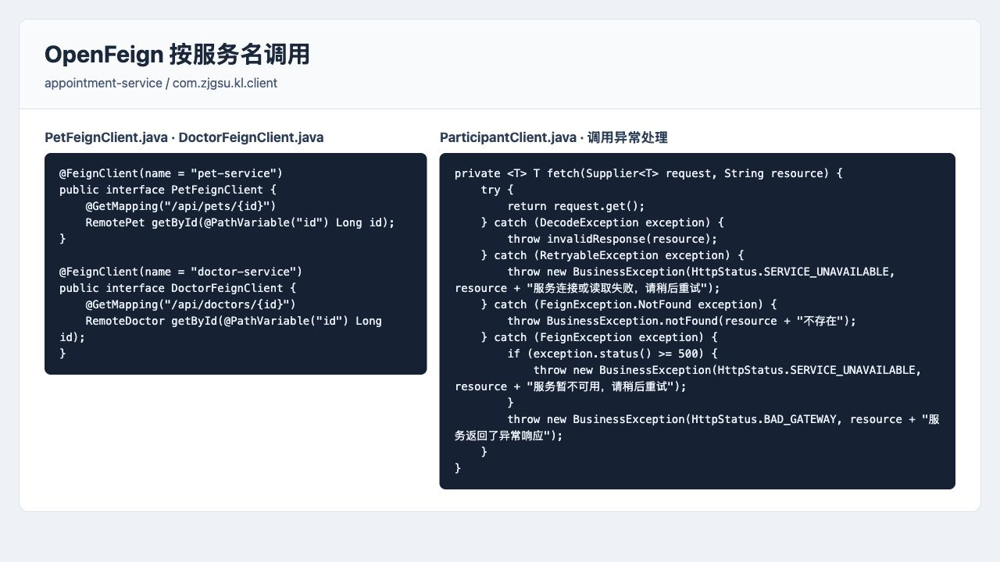
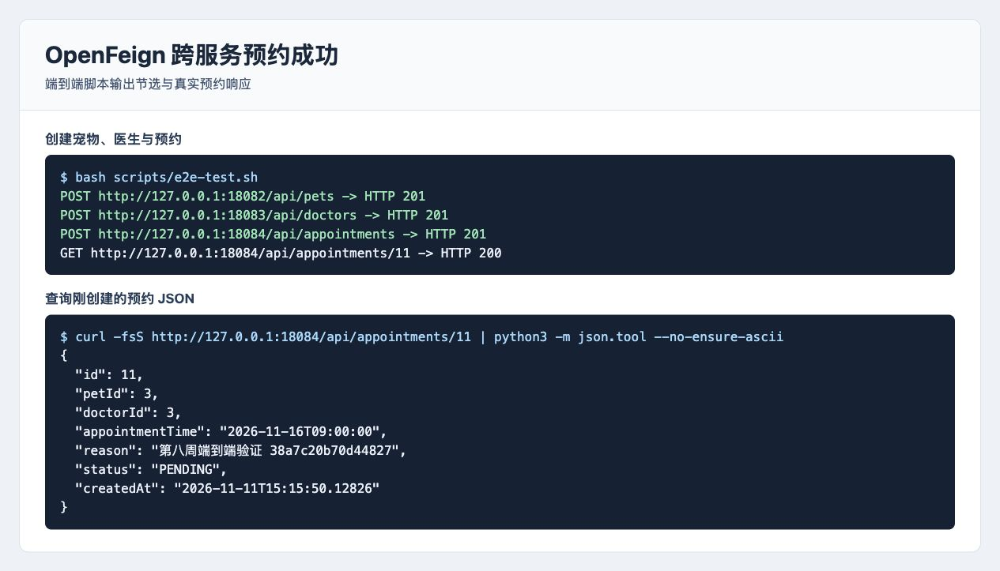
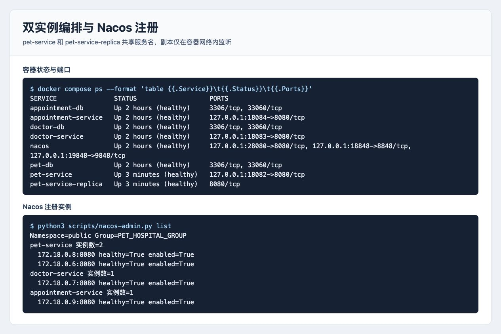
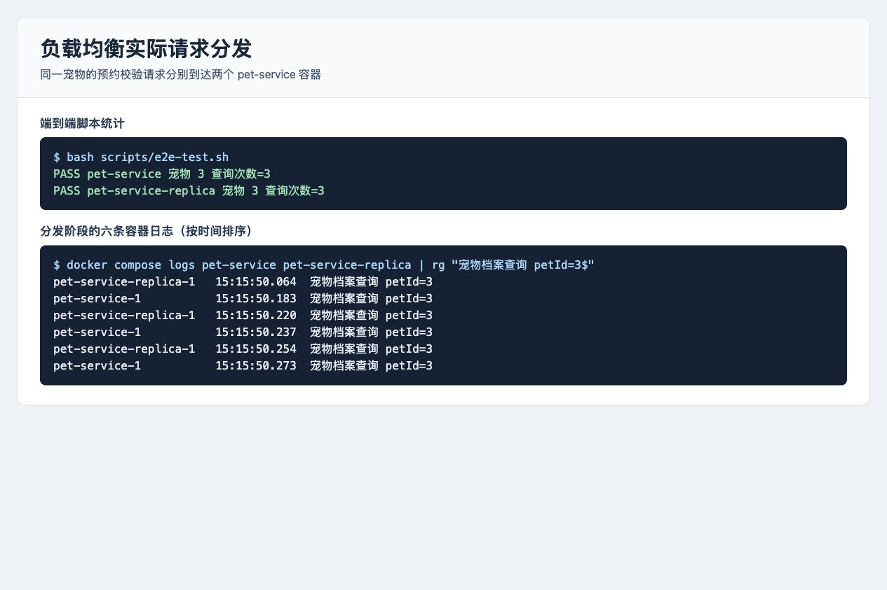
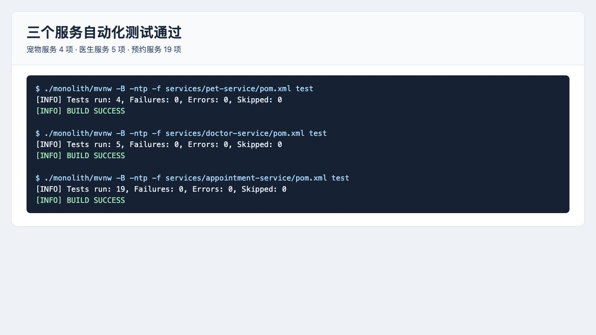
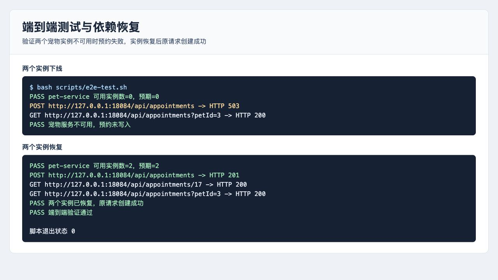

# 第 08 周作业记录

## 选题与实现范围

本周继续开发宠物医院管理系统，围绕「创建预约」实现跨服务同步调用。预约服务使用 OpenFeign 查询宠物和医生，Spring Cloud LoadBalancer 根据 Nacos 实例列表分发请求。通过两个宠物服务实例验证实际分发，并用服务层测试与端到端脚本检查正常流程和依赖故障。

## 选择一个跨服务业务流程

### 实现思路

客户端向预约服务提交宠物编号、医生编号、预约时间和就诊原因。预约服务先确认宠物存在，再查询医生的排班和接诊状态。远程查询及本地时段、冲突校验全部通过后，预约服务将记录保存到自己的数据库，返回 `201 Created` 和预约 JSON。调用方、被调用方和接口路径见[服务通信与负载均衡](../../service-communication.md)。



### 运行命令与验证结果

在仓库根目录启动 Compose 后运行 `bash scripts/e2e-test.sh`。2026 年 11 月 11 日的验证创建了编号均为 `3` 的宠物和医生，第一次预约创建返回 `201`。查询预约 `11` 返回 `200`，响应中的宠物、医生、预约时间与请求一致，状态为 `PENDING`。

## 使用 OpenFeign

### 实现思路

预约服务引入 OpenFeign 和 Spring Cloud LoadBalancer 依赖，通过 `@EnableFeignClients` 启用客户端。两个 `@FeignClient` 分别以 `pet-service` 和 `doctor-service` 为目标，实例地址由 Nacos 服务发现与客户端负载均衡提供。

| 调用方 | 被调用方 | 请求路径 | 用途 |
| --- | --- | --- | --- |
| `appointment-service` | `pet-service` | `GET /api/pets/{id}` | 确认宠物存在 |
| `appointment-service` | `doctor-service` | `GET /api/doctors/{id}` | 获取医生排班和接诊状态 |

Feign 默认连接超时为 2 秒、读取超时为 3 秒。参与方查询统一由 `ParticipantClient` 校验和处理异常，错误响应包含可检查的 JSON。

| 依赖调用结果 | 预约接口结果 |
| --- | --- |
| 宠物或医生不存在 | `404`，说明缺少的资源 |
| 无可用实例、连接失败、读取超时或依赖返回 5xx | `503`，提示依赖暂不可用 |
| 响应无法解析、内容无效或依赖返回其他异常状态 | `502`，提示上游响应异常 |



### 运行命令与验证结果

```bash
bash scripts/e2e-test.sh
curl -fsS http://127.0.0.1:18084/api/appointments/11 | python3 -m json.tool
```

脚本先通过三个服务的业务接口创建宠物、医生和预约，再读取新预约并核对响应字段。图中编号来自本次验证，重新运行时使用脚本输出的新预约编号。



## 负载均衡验证

### 实现思路

根目录 `compose.yaml` 增加 `pet-service-replica`。主实例和副本使用同一镜像、连接同一宠物数据库，在 Nacos 的 `public` 命名空间和 `PET_HOSPITAL_GROUP` 分组下以 `pet-service` 注册。主实例通过宿主机端口 `18082` 提供访问，副本只在 Compose 网络内监听 `8080`。

### 运行命令

以下命令在仓库根目录执行。首次启动所需的本地 `.env` 与 Nacos 管理员初始化步骤见[项目 README](../../../README.md)。

```bash
docker compose up -d --build --wait --wait-timeout 240
docker compose ps
python3 scripts/nacos-admin.py list
bash scripts/e2e-test.sh
```

### 验证结果

Compose 中八个容器均为 `healthy`，Nacos 中 `pet-service` 有两个可用实例。脚本为同一宠物创建六个不同时段的预约，从两个容器各自的日志中统计本轮的档案查询。两个实例各收到三次查询，六次预约均创建并查询成功。





## 测试

### 各服务独立测试

预约服务使用 H2 和模拟的 Feign 客户端，验证参与方校验、依赖故障、异常响应以及预约时间和冲突规则。以下测试命令在仓库根目录运行。

```bash
./monolith/mvnw -B -ntp -f services/pet-service/pom.xml test
./monolith/mvnw -B -ntp -f services/doctor-service/pom.xml test
./monolith/mvnw -B -ntp -f services/appointment-service/pom.xml test
```

宠物服务 4 项、医生服务 5 项、预约服务 19 项，共 28 项全部通过，失败、错误和跳过数均为 0。



### 端到端验证与依赖恢复

```bash
bash scripts/e2e-test.sh
```

脚本等待服务注册，创建测试宠物和医生，逐次核对预约创建与查询的状态码和 JSON，并检查两个容器的实际查询日志。随后模拟资源缺失和依赖下线，比较该宠物的预约 ID 集合，确认失败请求没有新增记录。脚本负责恢复两个宠物服务实例，实例重新注册后重试同一条预约请求。

| 验证场景 | 实际结果 | 该宠物的预约记录 |
| --- | --- | --- |
| 正常提交六次预约 | 创建均返回 `201`，查询均返回 `200` | 6 条 |
| 宠物不存在 | 返回 `404` | 仍为 6 条 |
| 两个宠物服务实例均下线 | 返回 `503` | 仍为 6 条 |
| 两个实例恢复后重试 | 创建返回 `201`，查询预约 `17` 返回 `200` | 增加至 7 条 |

脚本退出状态为 `0`。复验会新增测试数据，并在运行期间短暂停止两个宠物服务实例。



### 写操作超时的处理

当前跨服务校验使用 GET，依赖查询失败会在预约写入前结束请求。如果客户端等待创建预约的 POST 响应时超时，服务端可能已经保存记录，结果仍需确认。应先查询该宠物的预约，核对医生及时段，再决定是否重试。首次请求已保存时，重复提交可能返回 `409`。
