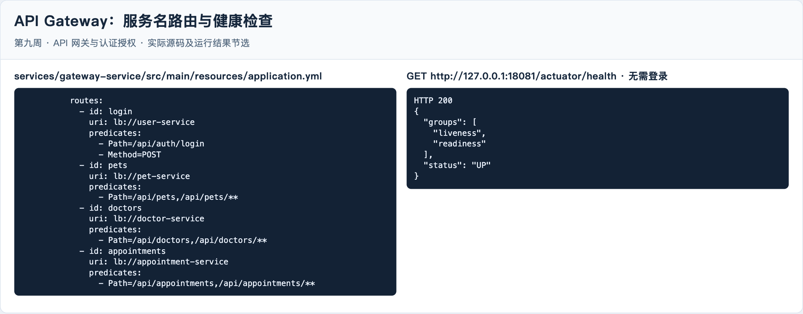
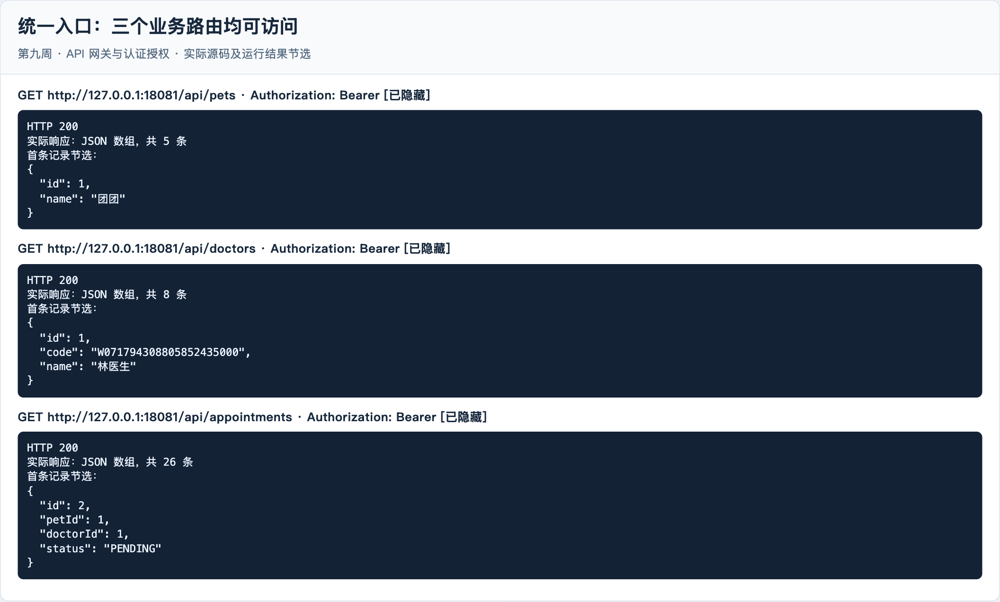
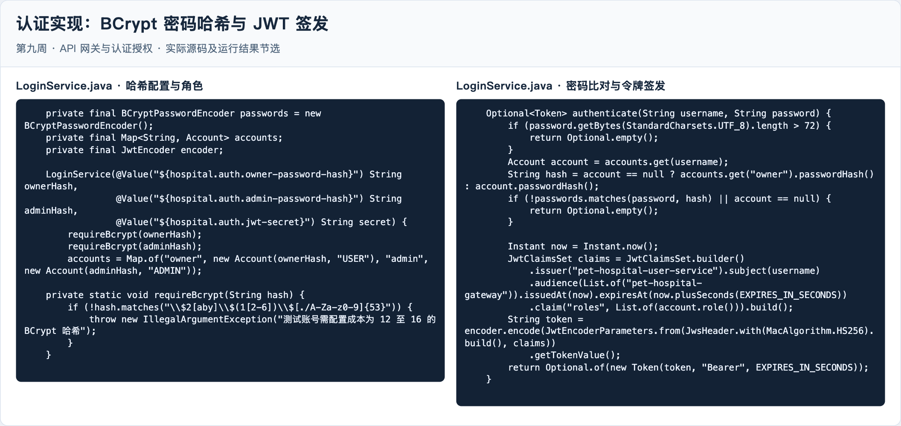
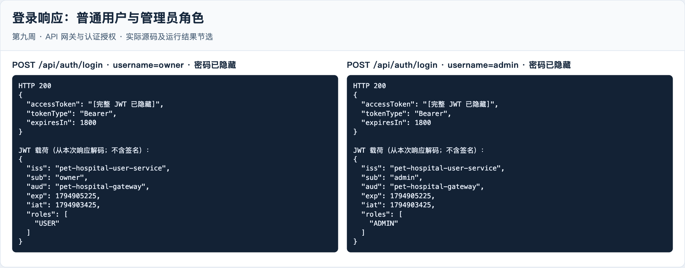
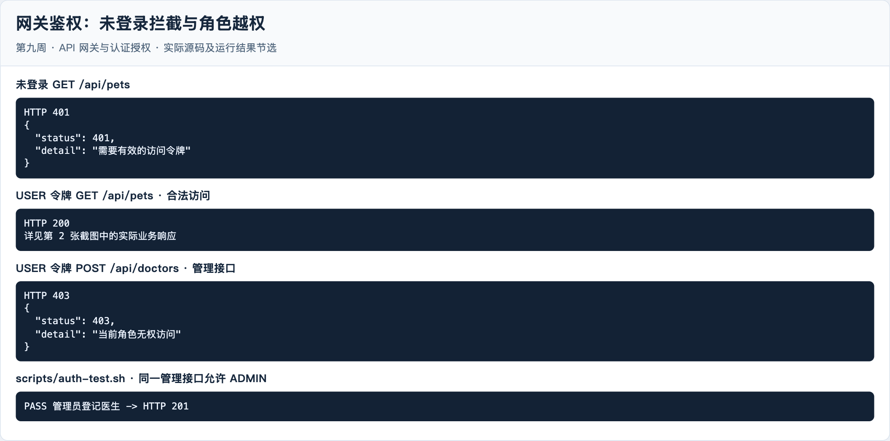
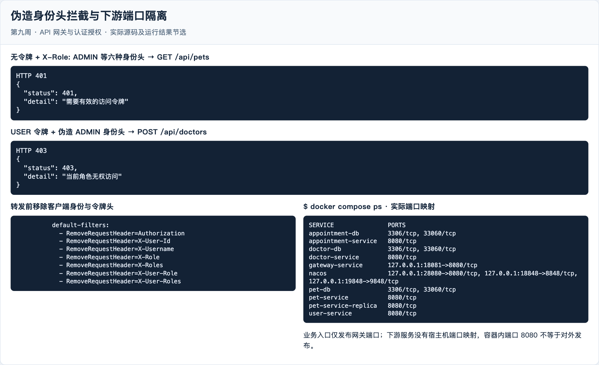
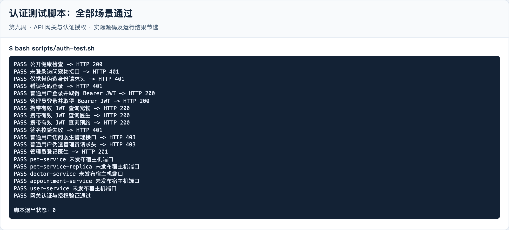
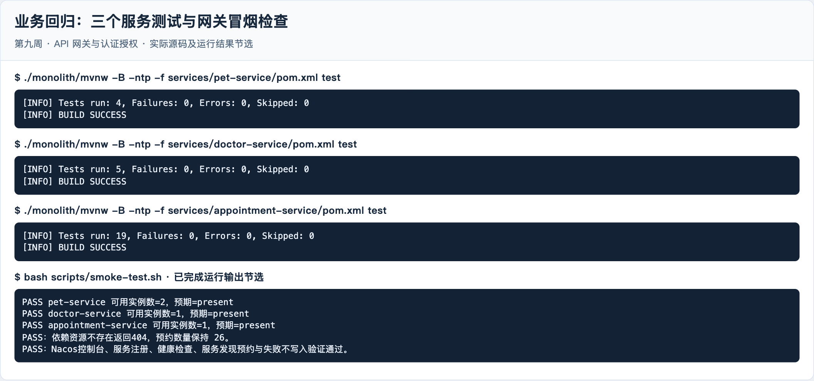

# 第 09 周作业记录

## 选题与实现范围

本周继续开发宠物医院管理系统，新增独立的 API 网关与用户认证服务。客户端通过统一入口获取 JWT，再携带令牌访问宠物、医生和预约接口。网关验证签名和角色，拦截未登录、无效令牌及越权请求，业务服务之间保留上一周的 OpenFeign 调用与负载均衡。

网关工程位于 `services/gateway-service/`，认证工程位于 `services/user-service/`，启动与端口映射由根目录 `compose.yaml` 管理。认证流程、完整路由和权限规则见[API 网关与认证授权](../../security.md)，测试账号与本地凭据配置见[项目 README](../../../README.md#十九第九周-api-网关与认证授权)。以下命令均在仓库根目录执行。

## API Gateway

### 实现思路

使用 Spring Cloud Gateway WebFlux 建立网关，容器内监听 `8080`，默认宿主机入口为 `http://127.0.0.1:18081`。`GATEWAY_PORT` 可调整宿主机端口。网关通过 Nacos 获取实例，使用 Spring Cloud LoadBalancer 按服务名转发，不写死容器 IP。

| 路径 | 目标服务 | 用途 |
| --- | --- | --- |
| `POST /api/auth/login` | `lb://user-service` | 登录并签发 JWT |
| `/api/pets`、`/api/pets/**` | `lb://pet-service` | 宠物档案 |
| `/api/doctors`、`/api/doctors/**` | `lb://doctor-service` | 医生与排班 |
| `/api/appointments`、`/api/appointments/**` | `lb://appointment-service` | 就诊预约与状态管理 |

网关自身保留公开的 `GET /actuator/health`。具体授权按 HTTP 方法和路径限制，路由存在不代表所有请求均可访问。

### 运行命令与验证结果

完成 `.env` 中的数据库、Nacos 和认证配置后启动服务。

```bash
docker compose up -d --build --wait --wait-timeout 240
docker compose ps
curl -fsS http://127.0.0.1:18081/actuator/health
bash scripts/auth-test.sh
```

2026 年 11 月 17 日验证中，网关健康检查返回 `200` 和 `UP`。普通用户登录后，通过同一个网关地址查询宠物、医生和预约，三个接口均返回 `200` 与 JSON 数组。截图中分别为 5 条宠物、8 条医生和 26 条预约；重复测试会新增数据，条数以当次响应为准。





## 认证服务

### 实现思路

`user-service` 提供 `POST /api/auth/login`，接收用户名和密码。测试账号 `owner` 对应 `USER`，`admin` 对应 `ADMIN`。账号保存 BCrypt 哈希，启动时校验哈希格式与成本，登录使用 `BCryptPasswordEncoder.matches` 比对，不在代码或数据库中保存明文密码。

凭据正确时返回 `200`，响应包含 `accessToken`、`tokenType=Bearer` 和 `expiresIn=1800`，同时设置 `Cache-Control: no-store`。JWT 使用 HS256 签名，载荷包含签发方、接收方、账号、签发时间、过期时间和角色数组。用户名不存在或密码错误返回 `401`。

签名密钥与两项密码哈希从本地 `.env` 注入，测试密码由操作者设置，通过环境变量或已被 Git 忽略的 `.env.auth-test` 提供。文档与截图仅展示字段结构、角色和脱敏结果。



### 运行命令与验证结果

```bash
bash scripts/auth-test.sh
```

普通用户和管理员登录均返回 `200`，令牌类型均为 `Bearer`，有效期均为 1800 秒。解码本次响应的载荷后，`sub` 分别为 `owner`、`admin`，`roles` 分别为 `USER`、`ADMIN`。错误密码登录返回 `401`，篡改令牌签名后访问受保护接口也返回 `401`。



## 网关鉴权

### 实现思路

网关使用 Spring Security Resource Server 验证 JWT 的 HS256 签名、时间声明、签发方与接收方，再读取 `roles` 授权。公开入口为健康检查和登录；查询宠物、医生和预约，以及新增宠物、创建和取消预约允许 `USER` 或 `ADMIN`；登记医生、确认和完成预约要求 `ADMIN`。

缺少或无效令牌返回 `401`，角色不满足返回 `403`，错误体包含 `status` 和 `detail`。未明确允许的请求统一拒绝，完整规则见[接口权限表](../../security.md#接口权限表)。

转发前移除六种客户端身份请求头及 `Authorization`。三个业务服务、宠物服务副本和用户服务均不发布宿主机端口，客户端从网关统一访问。容器内部通信属于受信任的服务网络，下游自身不重复验签，具备 Docker 管理权限的操作者仍能在容器网络内直接调用。当前为角色级授权，尚未按宠物主人归属隔离记录。

### 运行命令与验证结果

```bash
curl -i http://127.0.0.1:18081/api/pets
bash scripts/auth-test.sh
docker compose ps
```

| 验证场景 | 实际状态码 | 结果 |
| --- | --- | --- |
| 未登录查询宠物 | 401 | 网关拒绝请求 |
| 有效 `USER` 令牌查询三个业务列表 | 200 | 返回业务 JSON 数组 |
| `USER` 登记医生 | 403 | 拒绝管理操作 |
| `ADMIN` 登记医生 | 201 | 返回新医生记录 |
| 无令牌，仅伪造管理员身份请求头 | 401 | 无法替代 JWT 登录 |
| 有效 `USER` 令牌并伪造管理员身份请求头 | 403 | 无法提升为管理员 |
| 篡改令牌签名 | 401 | 验签失败 |





## 测试脚本

### 实现思路与运行命令

`scripts/auth-test.sh` 可从仓库根目录直接运行，公共登录与请求工具位于 `scripts/test_auth.py`。脚本读取 Compose 中的实际网关端口，检查状态码、JSON 类型、登录令牌和管理员新增记录，并通过 `docker port` 确认五个下游服务未发布宿主机端口。

```bash
bash scripts/auth-test.sh
AUTH_TEST_STATUS=$?
printf '认证测试退出状态 %s\n' "$AUTH_TEST_STATUS"
```

脚本覆盖未登录、错误密码、两种角色登录、带令牌访问、篡改签名、低权限越权和伪造身份请求头。符合预期输出 `PASS`，全部通过退出 `0`；状态码或响应内容异常、请求失败、容器检查失败时输出 `FAIL` 并以非零状态退出。每次成功运行会新增一条随机唯一编码的测试医生记录。

### 认证与授权验证结果

2026 年 11 月 17 日执行认证脚本，公开入口、登录、业务查询、未授权拦截、角色校验、伪造身份头及端口检查全部通过，最后输出“网关认证与授权验证通过”，退出状态为 `0`。



### 业务回归验证

原有冒烟和端到端脚本已改为登录后通过网关调用业务。以下命令用于复验；端到端脚本会短暂停止并恢复两个宠物服务实例，验证依赖故障与恢复流程。

```bash
bash scripts/smoke-test.sh
bash scripts/e2e-test.sh
./monolith/mvnw -B -ntp -f services/pet-service/pom.xml test
./monolith/mvnw -B -ntp -f services/doctor-service/pom.xml test
./monolith/mvnw -B -ntp -f services/appointment-service/pom.xml test
```

本周冒烟验证通过，两个宠物实例及医生、预约服务均可被发现；依赖资源不存在时返回 `404`，该轮预约总数保持为 26。三个业务服务分别通过 4、5、19 项测试，共 28 项，失败、错误和跳过数均为 0。认证与授权的集成验证由 `auth-test.sh` 完成。


