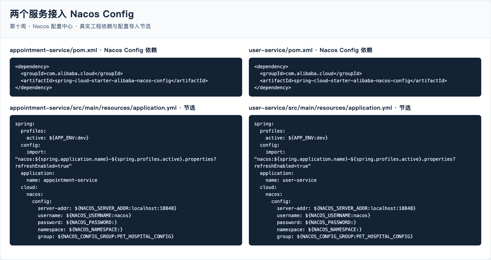
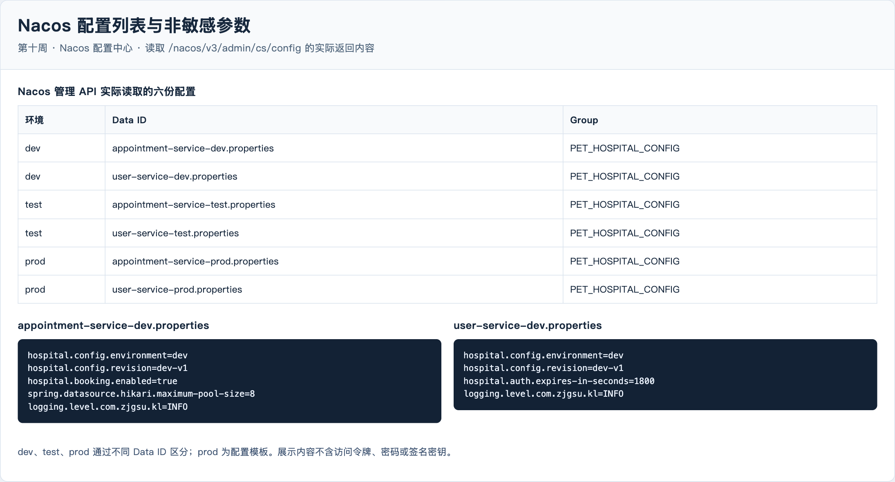
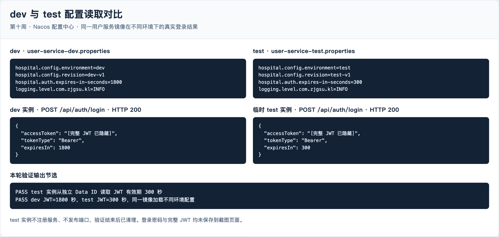
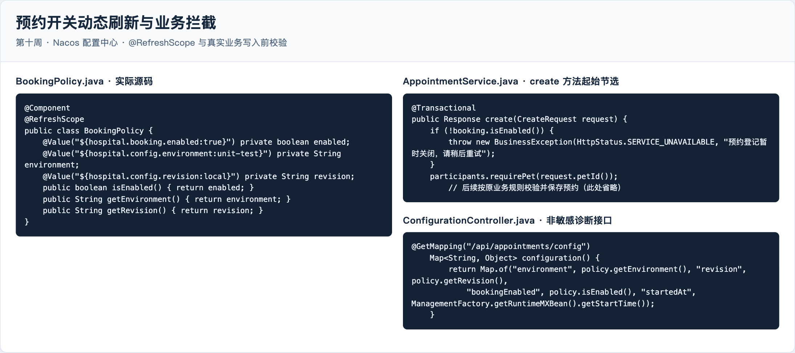
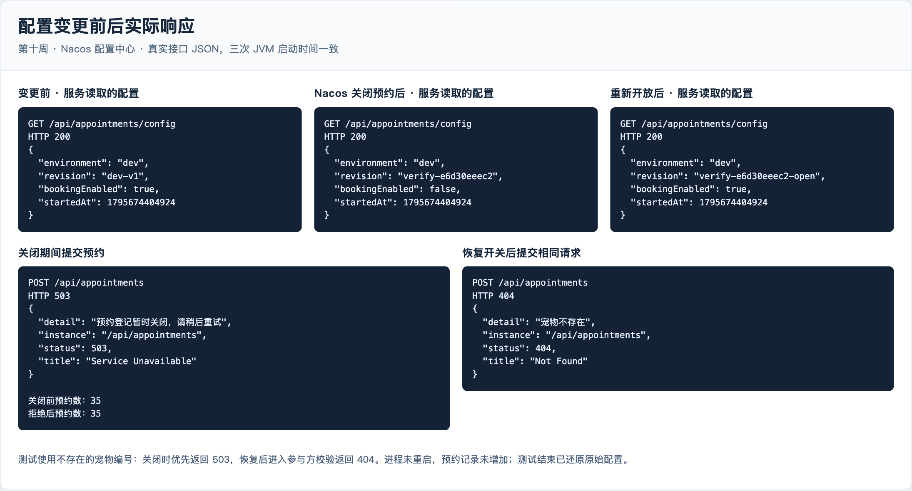
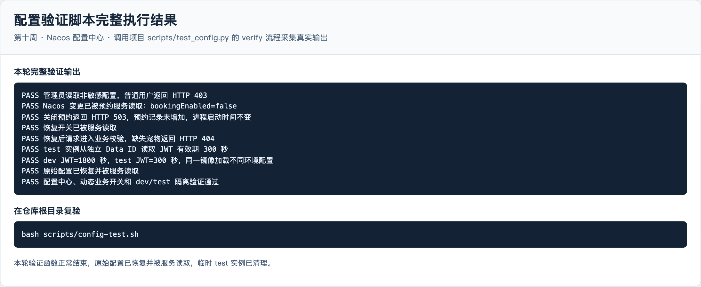
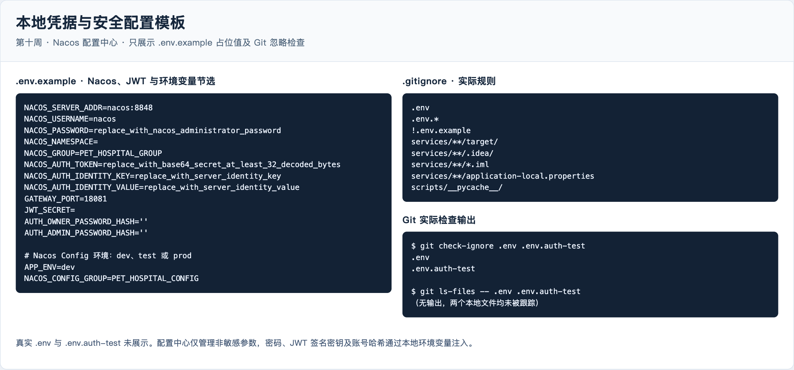

# 第 10 周作业记录

## 选题与实现范围

本周继续开发宠物医院管理系统，在上一周网关和 JWT 认证的基础上接入 Nacos Config。预约服务集中管理预约开关、连接池大小和日志级别，用户服务集中管理 JWT 有效期。通过 dev、test 环境读取不同配置，并验证预约开关变更能在运行中的服务生效。

配置与代码位于 `services/appointment-service/`、`services/user-service/`，环境配置示例位于 `configs/nacos/`，编排入口为根目录 `compose.yaml`。Data ID、Group、用途和配置边界见[Nacos 配置说明](../../configuration.md)，本地环境变量设置见[项目 README](../../../README.md#二十第十周-nacos-配置中心)。以下命令均在仓库根目录执行。

## 配置中心

### 实现思路

预约服务和用户服务引入 `spring-cloud-starter-alibaba-nacos-config`，版本由 Spring Cloud Alibaba `2025.1.0.0` BOM 管理。两个服务均通过 `spring.config.import` 加载 Nacos 配置，Data ID 由服务名和当前环境组成，开启 `refreshEnabled=true`。

```yaml
spring:
  profiles:
    active: ${APP_ENV:dev}
  config:
    import: "nacos:${spring.application.name}-${spring.profiles.active}.properties?refreshEnabled=true"
```

配置内容只包含适合集中管理的非敏感参数，数据库密码、Nacos 密码、JWT 签名密钥和账号密码哈希仍从本地环境变量注入。配置发布脚本只允许预设的配置键，默认创建缺失配置并保留已有内容，需要显式传入 `--overwrite` 才按仓库示例覆盖。



### 运行命令与验证结果

首次启动前，先完成本地凭据配置、Nacos 管理员初始化和配置发布，再启动业务服务。

```bash
docker compose up -d --wait --wait-timeout 180 nacos
python3 scripts/nacos-admin.py init
python3 scripts/nacos-config.py --env dev
python3 scripts/nacos-config.py --env test
docker compose up -d --build --wait --wait-timeout 240
bash scripts/config-test.sh
```

2026 年 11 月 26 日通过 Nacos 管理 API 读取到两个服务在 dev、test、prod 下的六份配置，Group 为 `PET_HOSPITAL_CONFIG`。dev 预约配置中的预约开关为 `true`、连接池最大连接数为 `8`，dev 用户配置中的 JWT 有效期为 `1800` 秒。prod 配置已作为模板发布，不代表生产环境已部署。



## 多环境配置

### 实现思路

`APP_ENV` 选择 `dev`、`test` 或 `prod`，默认 `dev`。每个环境使用独立 Data ID；`NACOS_NAMESPACE` 留空对应 `public`，`NACOS_CONFIG_GROUP` 默认值为 `PET_HOSPITAL_CONFIG`。配置中心 Group 与服务发现使用的 `NACOS_GROUP` 分别设置。

| 环境 | 预约服务 Data ID | 用户服务 Data ID | 用户 JWT 有效期 |
| --- | --- | --- | --- |
| dev | `appointment-service-dev.properties` | `user-service-dev.properties` | 1800 秒 |
| test | `appointment-service-test.properties` | `user-service-test.properties` | 300 秒 |
| prod | `appointment-service-prod.properties` | `user-service-prod.properties` | 模板为 900 秒 |

独立 Data ID 隔离环境配置。完整部署多套环境时，还需分别设置数据库、Compose 项目名、端口及服务发现分组。本次 test 验证只启动同一用户服务镜像的临时实例，不注册服务、不发布端口、不连接业务数据库，避免进入 dev 调用链。

### 运行命令与验证结果

```bash
python3 scripts/nacos-config.py --env dev
python3 scripts/nacos-config.py --env test
bash scripts/config-test.sh
```

脚本启动临时用户服务时设置 `APP_ENV=test`，并关闭服务注册。对 dev 和 test 实例分别实际登录，返回的 `tokenType` 均为 `Bearer`，`expiresIn` 分别为 `1800` 和 `300`，与各自远程配置一致。临时 test 实例在验证结束后清理，截图隐藏完整 JWT 和密码。



## 动态配置验证

### 实现思路

选择 `hospital.booking.enabled` 作为动态观察的业务开关。`BookingPolicy` 通过 `@RefreshScope` 读取预约开关、环境名和修订标识。创建预约时先检查开关，关闭时返回 `503` 和“预约登记暂时关闭，请稍后重试”，在查询下游和保存预约之前结束请求。

管理员通过网关访问 `GET /api/appointments/config`，可读取明确列出的非敏感字段：`environment`、`revision`、`bookingEnabled` 和 JVM 启动时间 `startedAt`。未登录返回 `401`，普通用户返回 `403`。该接口不暴露完整配置环境或凭据。



### 运行命令与验证结果

```bash
bash scripts/config-test.sh
CONFIG_TEST_STATUS=$?
printf '配置测试退出状态 %s\n' "$CONFIG_TEST_STATUS"
```

脚本备份 dev 预约配置，发布关闭开关和新的修订标识，轮询服务接口确认新值已读取。随后恢复开关，验证业务行为恢复，最后还原最初配置。

本轮截图使用不存在的宠物编号，比较同一请求在开关关闭和重新开放后的结果。

| 阶段 | 服务实际读取结果 | 创建预约响应 | 数据与进程证据 |
| --- | --- | --- | --- |
| 变更前 | `bookingEnabled=true`，`revision=dev-v1` | 作为配置基线 | 记录 JVM 启动时间 |
| Nacos 关闭预约后 | `bookingEnabled=false`，读取到本轮新修订标识 | `503`，预约登记暂时关闭 | 预约数保持 35，启动时间不变 |
| 重新开放后 | `bookingEnabled=true`，读取到开放后的修订标识 | `404`，宠物不存在 | 重新进入参与方校验，启动时间仍不变 |
| 验证结束 | 原始 `dev-v1` 配置恢复并被服务读取 | 恢复原有业务设置 | 临时 test 实例清理完成 |

恢复后的 `404` 来自特意使用的缺失宠物，说明请求已越过预约开关，继续执行原有业务校验。三次配置响应的 `startedAt` 完全一致，证明变更无需重新打包或重启。预约数量为本轮截图结果，后续业务测试新增数据后以当次查询为准。



`scripts/config-test.sh` 调用 `scripts/test_config.py`，验证服务真实读取值、业务响应、管理员权限、dev/test 差异及恢复清理。全部通过输出 `PASS` 并退出 `0`，异常输出 `FAIL` 并退出非零。截图采集调用了同一验证函数，记录了完整输出；本周直接运行入口脚本也已通过。



本周还通过了预约服务 20 项测试，以及鉴权、冒烟和端到端验证。新增预约测试覆盖开关关闭后不调用下游、不新增记录，以及刷新恢复后可以继续创建。以下命令可分别复验。

```bash
./monolith/mvnw -B -ntp -f services/appointment-service/pom.xml test
bash scripts/auth-test.sh
bash scripts/smoke-test.sh
bash scripts/e2e-test.sh
```

端到端脚本会新增测试数据，并短暂停止和恢复两个宠物服务实例；配置验证期间不要同时修改同一 Data ID。

## 安全配置

### 实现思路

仓库提供 [.env.example](../../../.env.example)，包含变量名和占位值，真实 `.env` 与 `.env.auth-test` 已由 `.gitignore` 忽略。本地环境变量设置方法见 [README](../../../README.md#本地环境变量设置)。JWT 密钥和真实密码不写入示例、截图或远程业务配置，用户服务接收账号密码哈希，验证脚本只在本地读取测试密码。

远程配置发布脚本使用配置键白名单，范围包括环境、修订标识、预约开关、JWT 有效期、连接池大小和日志级别。该限制约束项目脚本的发布内容；Nacos 管理员仍应按相同边界维护配置。

### 运行命令与验证结果

```bash
git check-ignore .env .env.auth-test
git ls-files -- .env .env.auth-test
```

第一条命令输出两个本地文件名，确认被忽略；第二条命令无输出，确认未被 Git 跟踪。截图只显示模板占位值和忽略规则。配置读取接口仅允许管理员访问，普通用户访问返回 `403`，未向客户端开放完整 Environment。


