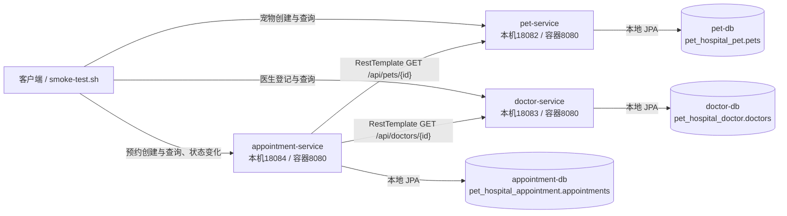

# 微服务拆分设计

## 第七周工作

宠物、医生和预约三个服务接入 Nacos `3.2.4`，服务名分别为 `pet-service`、`doctor-service`、`appointment-service`，命名空间为默认 `public`，分组为 `PET_HOSPITAL_GROUP`。预约服务通过 `DiscoveryClient` 每次获取当前实例，使用实例 URI 调用宠物和医生的原有业务 API。实例列表为空或依赖连接失败时返回 `503`，资源不存在时返回 `404`，失败校验在预约写入前终止。

Nacos 控制台本机端口为 `28080`，Server HTTP 为 `18848`，SDK gRPC 为 `19848`。应用容器使用 `nacos:8848` 连接注册中心，数据由 `nacos_data` 命名卷保存。三个业务服务各自的数据归属延续第六周设计，详细运行过程与验证截图见 [第 07 周作业记录](homework/week-07/index.md)。

## 第六周工作与拆分范围

本周在宠物医院管理系统的基础上，将已有宠物档案、医生排班和就诊预约拆分为三个独立 Spring Boot 服务。保留 `monolith/` 及原有数据库卷，单体工程不改名、不覆盖；新工程统一位于 `services/`，每个服务都有独立 `pom.xml`、`src/`、配置、测试和 Dockerfile。

拆分依据是已有业务职责，而不是将 Controller、Service、Repository 按技术层分成不同服务。当前尚无独立用户账户模块，主人姓名和电话仍属于宠物档案，本周不新增用户登录或账户服务，也不引入注册中心、网关、消息队列或分布式事务。

## 单体到微服务的映射

| 单体模块 | 独立服务 | 负责内容 | 本机端口 | 独立数据库 | 账号 | 拥有的数据表 |
| --- | --- | --- | --- | --- | --- | --- |
| `Pet`、`PetController`、`PetService`、`PetRepository` | `pet-service` | 宠物档案创建、列表和详情查询 | 18082 | `pet_hospital_pet` | `pet_user` | `pets` |
| `Doctor`、`DoctorController`、`DoctorService`、`DoctorRepository` | `doctor-service` | 医生与每周出诊时间、接诊状态、工号唯一性 | 18083 | `pet_hospital_doctor` | `doctor_user` | `doctors` |
| `Appointment`、`AppointmentController`、`AppointmentService`、`AppointmentRepository` | `appointment-service` | 预约创建、查询、时段冲突和状态流转 | 18084 | `pet_hospital_appointment` | `appointment_user` | `appointments` |

应用容器内部均监听 `8080`。本机采用 `18082～18084`，避开课内项目及原单体端口；端口可通过环境变量覆盖。各服务基础包继续使用 `com.zjgsu.kl`，分层代码放在各自的 `model`、`dto`、`controller`、`service`、`repository` 等子包。

三个 Maven 工程相互独立，不依赖其他服务的 JAR、实体或 Repository。每个服务仅扫描和加载自身工程中的代码。

## 数据归属与隔离

每个服务使用一个独立 MySQL 8.4.11 容器、业务数据库、应用账号及命名卷：

| 服务 | 数据库服务名 | 容器数据库端口 | 数据卷 |
| --- | --- | --- | --- |
| `pet-service` | `pet-db` | 3306，仅 Compose 网络内访问 | `pet_data` |
| `doctor-service` | `doctor-db` | 3306，仅 Compose 网络内访问 | `doctor_data` |
| `appointment-service` | `appointment-db` | 3306，仅 Compose 网络内访问 | `appointment_data` |

各应用只使用对应的业务账号连接自己的数据库，不使用 MySQL 管理员账号。三个数据库均不映射宿主机端口。命名卷保存数据库文件，容器重建后继续使用原卷，日常停止不删除数据卷。

`pets` 保存宠物和当前简化的主人信息；`doctors` 保存医生和每周出诊安排；`appointments` 保存 `pet_id`、`doctor_id`、预约时间、占位时间、状态、原因和创建时间。

预约实体中的 `petId` 和 `doctorId` 均为普通数值 ID，不建立跨服务 JPA 关联或数据库外键，不跨数据库联表，也不直接调用其他服务的 Repository。依赖资源是否存在由 HTTP API 校验。历史预约查询读取预约服务自己的记录，不要求宠物服务或医生服务实时可用。

原单体的 `mysql_data` 卷保持不变。本周不自动迁移或复制单体历史数据，新服务通过各自的 API 创建数据，避免将旧 ID 直接当作新数据库中的 ID。

## 服务调用关系



容器之间通过 Compose 服务名访问，不使用 `localhost` 连接其他容器。预约服务的 `application.yml` 提供 `clients.pet-base-url`、`clients.doctor-base-url`，分别可由 `PET_SERVICE_URL`、`DOCTOR_SERVICE_URL` 覆盖；Compose 默认注入 `http://pet-service:8080` 和 `http://doctor-service:8080`。

HTTP 使用作业要求的 `RestTemplate`，连接超时默认为 `2s`，读取超时默认为 `3s`，可通过 `HTTP_CONNECT_TIMEOUT`、`HTTP_READ_TIMEOUT` 覆盖。超时必须为正数，不允许以无限等待代替失败处理。

## 跨服务预约流程

1. 客户端向宠物服务创建宠物，获得实际 `petId`。
2. 客户端向医生服务登记出诊安排，获得实际 `doctorId`。
3. 客户端向预约服务提交宠物编号、医生编号、未来预约时间和就诊原因。
4. 预约服务通过 HTTP 查询宠物详情，确认宠物存在。
5. 预约服务通过 HTTP 查询医生详情，获得出诊星期、起止时间和接诊状态。
6. Service 校验医生接诊、预约在未来、按半小时对齐，并完整落在医生出诊范围内。
7. 在预约数据库内检查医生及宠物时段冲突，通过本地事务保存 `PENDING` 预约，返回 `201`。
8. 客户端查询预约，返回 `200`；确认、完成和取消仍在预约服务中按原有状态规则处理。

预约数据库保留 `doctor_id + active_slot` 和 `pet_id + active_slot` 两个联合唯一约束，防止并发检查后重复写入。确认、完成和取消使用预约表本地行锁；取消保留历史，并将占位时间清空，允许重新预约。

## 失败响应与本地数据变化

| 场景 | 返回状态 | 处理方式 | 本地预约数据 |
| --- | --- | --- | --- |
| 请求参数缺失或非法 | 400 | DTO 校验拒绝 | 不新增 |
| 宠物或医生接口返回不存在 | 404 | 明确返回依赖资源不存在 | 不新增 |
| HTTP 连接失败、读取超时或依赖返回 5xx | 503 | 明确返回对应服务暂不可用 | 不新增 |
| 依赖响应无法解析、编号不匹配或必要字段缺失 | 502 | 拒绝使用无效远端数据 | 不新增 |
| 出诊规则不满足或预约时段冲突 | 409 | Service 或本地数据库约束拒绝 | 不新增 |
| 校验通过且本地保存成功 | 201 | 返回实际预约编号和 Location | 新增一条 |

所有远端校验均在本地预约写入前完成，异常不会被吞掉，也不使用虚构的默认宠物或医生继续预约。错误统一使用 `ProblemDetail` 响应。服务不可用时，仍可读取已经保存在预约服务中的历史记录。

## “远端成功、本地失败”窗口

远端宠物和医生查询成功后，本地预约保存仍可能因唯一约束冲突、数据库故障或进程中断而失败。远端 HTTP 与本地事务不是同一个原子事务，因此不能将远端查询成功等同于预约创建成功。

本周远端调用只查询数据，不修改远端记录；本地失败时不产生成功预约，也无需回滚远端查询。如果后续增加远端资源修改或删除，还需要处理校验后远端状态改变的问题。本周只验证顺序调用和基本失败处理，不实现跨服务原子事务、自动补偿或消息一致性机制。

## 本地运行与测试入口

默认通过根目录 `compose.yaml` 一键启动三个微服务和各自数据库。原单体位于 `monolith` profile 中，可单独启动，不影响源码及历史数据。

根目录 `scripts/smoke-test.sh` 验证三个健康接口、宠物和医生创建、跨服务预约、预约查询、冲突拦截、确认取消、取消后重新预约及依赖资源不存在时不写入。附加 `--with-unavailable` 时，还会暂时停止宠物服务，验证 `503` 和预约数量不变，随后恢复该服务。

每个服务有独立测试，使用 H2 内存数据库，不需要先启动 MySQL。预约服务测试通过 `MockRestServiceServer` 验证真实 RestTemplate 调用路径及错误处理，容器联调再验证真实网络请求。启动及测试命令见根目录 [README](../README.md)。

HTTP 客户端及超时配置依据 [Spring Framework REST Clients](https://docs.spring.io/spring-framework/reference/integration/rest-clients.html) 和 [SimpleClientHttpRequestFactory](https://docs.spring.io/spring-framework/docs/current/javadoc-api/org/springframework/http/client/SimpleClientHttpRequestFactory.html)；本周依照作业要求保留 RestTemplate。

## 第六周实际验证记录

2026 年 10 月 28 日完成首次容器联调。以下为首轮脚本的实际请求与结果，后续重复运行会生成新的资源编号，不能将本节编号当作固定测试数据。

创建宠物时提交“团团”、种类“猫”、年龄 `2`、主人姓名“孔磊”和示例联系电话；返回 `petId=1`。登记内科医生、周一 `09:00～17:00` 出诊并接诊，返回 `doctorId=1`。预约提交以下数据：

```json
{
  "petId": 1,
  "doctorId": 1,
  "appointmentTime": "2026-11-02T09:00:00",
  "reason": "第六周跨服务预约验证"
}
```

| 实际操作 | 状态码 | 结果与数据变化 |
| --- | --- | --- |
| 分别查询三个服务的 `/actuator/health` | 200 | 三个服务均为 `UP` |
| `POST :18082/api/pets` | 201 | 宠物服务新增宠物 `1` |
| `POST :18083/api/doctors` | 201 | 医生服务新增医生 `1` |
| `POST :18084/api/appointments` | 201 | 经两次远端查询后新增预约 `1`，状态为 `PENDING` |
| `GET :18084/api/appointments/1` | 200 | 返回刚创建的预约与参与方 ID |
| 重复提交同一时段预约 | 409 | 不新增预约 |
| 确认后取消预约 `1` | 200 / 200 | 原预约变为 `CANCELLED`，历史记录保留 |
| 重新提交相同时段预约 | 201 | 新增预约 `2`，本地预约共 `2` 条 |
| 将 `petId` 改为不存在的 `9223372036854775807` 后提交 | 404 | 返回“宠物不存在”，本地预约数量仍为 `2` |
| 停止 `pet-service` 后再次提交预约 | 503 | 返回“宠物服务连接或读取失败，请稍后重试”，本地预约数量仍为 `2` |
| 恢复 `pet-service` 并再次健康检查 | 200 | 服务重新为 `UP` |

数据库核对显示三个账号分别只拥有各自业务数据库的权限，每个数据库仅包含对应服务的数据表。预约数据库中不存在指向其他表的外键，关联通过数值 ID 和 HTTP 校验完成。

独立测试结果为宠物服务 `4` 项、医生服务 `5` 项、预约服务 `15` 项，全部通过。默认冒烟脚本重复执行通过；并发提交同一预约时分别返回 `201` 和 `409`，只新增一条预约，说明本地联合唯一约束在拆分后仍有效。

## 第六周补充验证记录

2026 年 11 月 1 日重复执行完整容器验证，新增宠物 `4`、医生 `4` 和预约 `7`。预约 `7` 创建及查询分别返回 `201`、`200`，重复提交返回 `409`；确认、取消后重新预约生成记录 `8`，原记录保留为 `CANCELLED`。

依赖资源不存在返回 `404`，停止宠物服务后返回 `503`，两种失败场景下预约总数均由 `7` 保持为 `7`。宠物服务恢复后健康接口返回 `200` 和 `UP`。三个服务共 `24` 项测试再次全部通过，完整请求、状态码、数据变化及九张截图见 [第 06 周作业记录](homework/week-06/index.md)。
