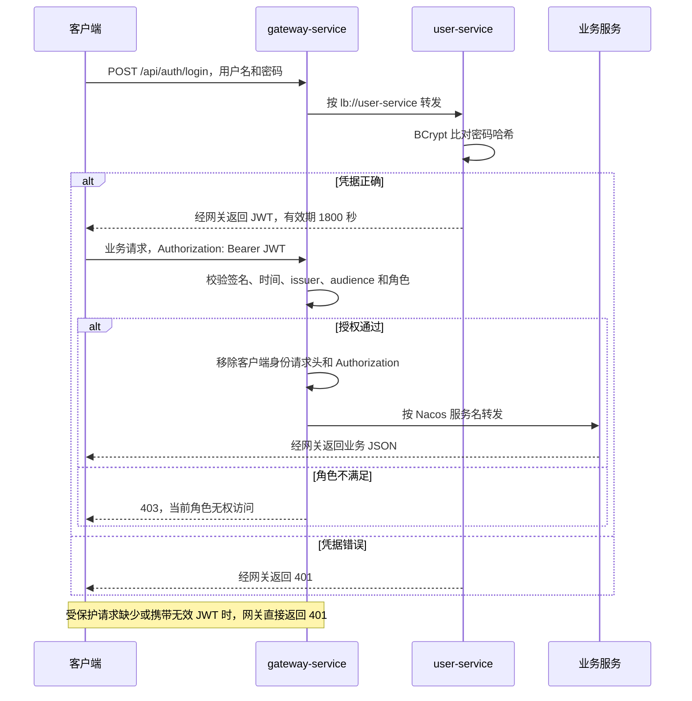

# API 网关与认证授权

## 实现范围

宠物医院系统通过 `gateway-service` 提供统一业务入口，在 `user-service` 中完成密码校验和 JWT 签发。网关验证令牌并按角色授权后，通过 Nacos 服务发现转发请求。创建预约时，预约服务继续通过 OpenFeign 查询宠物和医生。

默认入口为 `http://127.0.0.1:18081`，容器内端口为 `8080`。根目录 `compose.yaml` 通过 `GATEWAY_PORT` 调整宿主机端口。路由和请求头过滤见 [application.yml](../services/gateway-service/src/main/resources/application.yml)，鉴权规则见 [GatewaySecurity.java](../services/gateway-service/src/main/java/com/zjgsu/kl/GatewaySecurity.java)。

## 认证流程



登录接口接收 `username` 和 `password`。成功返回 `200`，并设置 `Cache-Control: no-store`。以下仅为响应结构示例，完整令牌已省略。

```json
{
  "accessToken": "<登录响应中的 JWT>",
  "tokenType": "Bearer",
  "expiresIn": 1800
}
```

JWT 使用 HS256 签名，包含以下声明。

| 声明 | 内容与用途 |
| --- | --- |
| `iss` | `pet-hospital-user-service`，签发方 |
| `aud` | `pet-hospital-gateway`，接收方 |
| `sub` | 登录账号 `owner` 或 `admin` |
| `iat`、`exp` | 签发和过期时间，有效期 30 分钟 |
| `roles` | `USER` 或 `ADMIN` 组成的数组 |

网关限定 HS256 算法，校验签名、时间声明、签发方和接收方，将 `roles` 转换为 Spring Security 的 `ROLE_` 权限。身份来源是校验通过的 JWT。网关不保存登录会话，每次受保护请求均需携带 Bearer 令牌。

## 测试账号与密码存储

| 测试账号 | 角色 | 主要权限 |
| --- | --- | --- |
| `owner` | `USER` | 查询宠物、医生和预约，新增宠物，创建及取消预约 |
| `admin` | `ADMIN` | 具有普通用户的上述权限，另可登记医生、确认及完成预约 |

[LoginService.java](../services/user-service/src/main/java/com/zjgsu/kl/LoginService.java) 在内存中维护两个测试账号与角色。账号配置保存 BCrypt 哈希，启动时要求哈希成本为 12 至 16，登录通过 `BCryptPasswordEncoder.matches` 比对。用户名不存在或密码错误均返回 `401`；请求字段为空或超过长度限制由参数校验拒绝。

本地 `.env` 中配置以下变量，网关和用户服务使用同一份 JWT 密钥。

| 配置项 | 内容 |
| --- | --- |
| `JWT_SECRET` | Base64 编码的随机密钥，解码后至少 32 字节 |
| `AUTH_OWNER_PASSWORD_HASH` | `owner` 的 BCrypt 哈希 |
| `AUTH_ADMIN_PASSWORD_HASH` | `admin` 的 BCrypt 哈希 |

生成密钥和哈希的方法见 [README 第九周配置](../README.md#十九第九周-api-网关与认证授权)。密码由操作者设置和保管。测试脚本从环境变量 `AUTH_OWNER_PASSWORD`、`AUTH_ADMIN_PASSWORD`，或本地 `.env.auth-test` 读取密码。`.env` 和 `.env.auth-test` 已由 Git 忽略，模板保留空值，文档与截图不包含真实密钥、密码或完整令牌。

## 网关路由表

网关通过 Nacos 的 `public` 命名空间、`PET_HOSPITAL_GROUP` 分组发现服务，目标使用 `lb://服务名`。网关作为发现客户端读取实例，不注册自身实例。

| 路由 ID | 路径匹配 | 目标 |
| --- | --- | --- |
| `login` | `POST /api/auth/login` | `lb://user-service` |
| `pets` | `/api/pets`、`/api/pets/**` | `lb://pet-service` |
| `doctors` | `/api/doctors`、`/api/doctors/**` | `lb://doctor-service` |
| `appointments` | `/api/appointments`、`/api/appointments/**` | `lb://appointment-service` |

`GET /actuator/health` 由网关自身处理并公开访问。业务请求仍须符合下表授权规则，未明确允许的请求统一拒绝。

## 接口权限表

| 方法与路径 | 允许角色 | 用途 |
| --- | --- | --- |
| `GET /actuator/health` | 无需登录 | 网关健康检查 |
| `POST /api/auth/login` | 无需登录 | 获取 JWT |
| `GET /api/pets`、`GET /api/pets/{id}` | `USER`、`ADMIN` | 查询宠物 |
| `POST /api/pets` | `USER`、`ADMIN` | 新增宠物 |
| `GET /api/doctors`、`GET /api/doctors/{id}` | `USER`、`ADMIN` | 查询医生和排班 |
| `POST /api/doctors` | `ADMIN` | 登记医生 |
| `GET /api/appointments`、`GET /api/appointments/{id}` | `USER`、`ADMIN` | 查询预约 |
| `POST /api/appointments` | `USER`、`ADMIN` | 创建预约 |
| `POST /api/appointments/{id}/cancel` | `USER`、`ADMIN` | 取消预约 |
| `POST /api/appointments/{id}/confirm` | `ADMIN` | 确认预约 |
| `POST /api/appointments/{id}/complete` | `ADMIN` | 完成预约 |

缺少、签名错误或其他校验不通过的访问令牌返回 `401`。令牌有效但角色不满足返回 `403`。网关错误体使用 `application/problem+json`，包含 `status` 和 `detail`，`401` 还带有 `WWW-Authenticate: Bearer`。

```json
{"status":401,"detail":"需要有效的访问令牌"}
```

```json
{"status":403,"detail":"当前角色无权访问"}
```

## 伪造身份请求头与下游访问边界

网关授权不读取客户端自报的身份。转发前移除 `X-User-Id`、`X-Username`、`X-Role`、`X-Roles`、`X-User-Role`、`X-User-Roles` 和 `Authorization`，避免下游将客户端身份头当作可信身份。无令牌但伪造管理员请求头仍返回 `401`；普通用户携带有效令牌并伪造管理员请求头，登记医生仍返回 `403`。

Compose 只发布网关业务端口；`pet-service`、`pet-service-replica`、`doctor-service`、`appointment-service` 和 `user-service` 均不发布宿主机端口，数据库也不发布宿主机端口。容器内的 `8080/tcp` 表示内部监听，不表示宿主机已有端口映射。外部客户端通过网关调用业务，预约服务在容器网络内通过 OpenFeign 查询依赖。

当前下游业务服务依赖受信任的 Compose 网络，本身不重复验签。具备 Docker 管理权限、能进入或加入该网络的操作者仍可直接访问下游，因此网络内服务和 Docker 管理权限属于信任边界。Nacos 管理端口独立发布且启用鉴权，用于服务注册和管理。

当前为角色级授权，账号尚未关联宠物主人记录，普通用户的查询及取消操作不按数据归属隔离。尚未实现注册、密码修改、刷新令牌和主动注销令牌。

## 验证方法与结果

完成本地凭据配置后，在仓库根目录执行。

```bash
docker compose up -d --build --wait --wait-timeout 240
curl -fsS http://127.0.0.1:18081/actuator/health
bash scripts/auth-test.sh
```

`auth-test.sh` 从 Compose 读取实际网关端口，覆盖未登录、伪造身份头、错误密码、两种角色登录、三个业务列表查询、篡改签名、普通用户越权和管理员正常写入，并逐个检查下游容器未发布端口。成功输出 `PASS` 并退出 `0`，发现异常输出 `FAIL` 并以非零状态退出。每次成功运行会新增一条带随机唯一编码的测试医生记录。

2026 年 11 月 17 日验证结果：健康接口 `200`，两种角色登录 `200`，携带有效令牌查询三个业务列表均为 `200`，未登录与篡改签名均为 `401`，普通用户登记医生及伪造管理员请求头均为 `403`，管理员登记医生为 `201`，五个下游服务均未发布宿主机端口，认证脚本退出 `0`。

详细实现记录与验证截图见[第 09 周作业记录](homework/week-09/index.md)。
