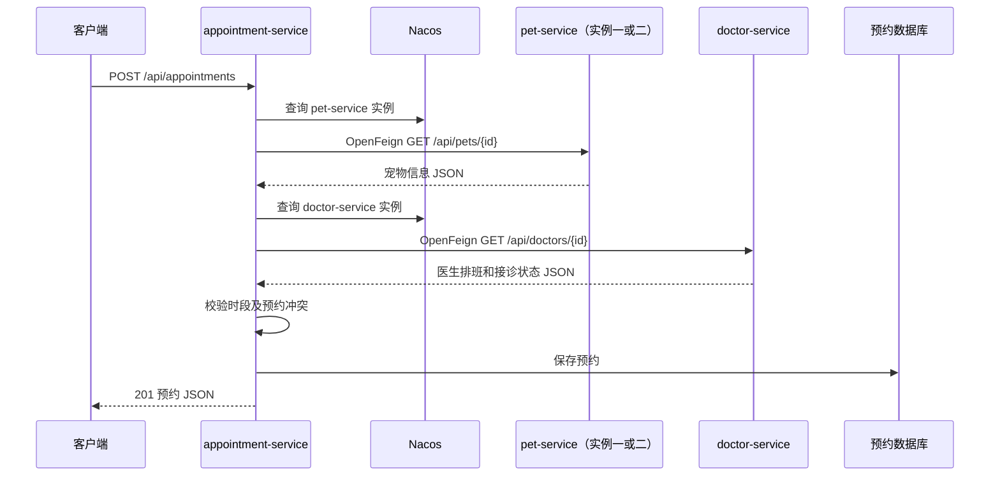

# 服务通信与负载均衡

创建预约需要确认宠物存在，并根据医生的出诊时间和接诊状态校验所选时段。预约服务负责预约规则及写入，宠物服务和医生服务分别提供各自的数据查询接口。

| 调用方 | 被调用方 | 接口 |
| --- | --- | --- |
| 客户端 | `appointment-service` | `POST /api/appointments` |
| `appointment-service` | `pet-service` | `GET /api/pets/{id}` |
| `appointment-service` | `doctor-service` | `GET /api/doctors/{id}` |

OpenFeign 使用服务名发起请求，Spring Cloud LoadBalancer 从 Nacos 提供的可用实例中轮询选择。两个宠物实例共享同一个宠物数据库，副本通过容器网络接收调用。运行整套 Compose 后，在仓库根目录执行 `bash scripts/e2e-test.sh`，脚本创建预约并检查两个容器各自的宠物查询日志。

宠物或医生不存在时，预约接口返回 404。没有可用实例、连接失败、读取超时或依赖返回 5xx 时返回 503。响应无法解析或内容不符合预期时返回 502。依赖校验失败发生在预约写入前。

本流程对依赖服务只发起 GET 请求。若客户端等待 `POST /api/appointments` 超时，预约可能已经提交，此时结果未知。客户端应先查询该宠物的预约并核对医生及时段，再决定是否重试。直接重试可能因首次请求已写入而返回 409。
